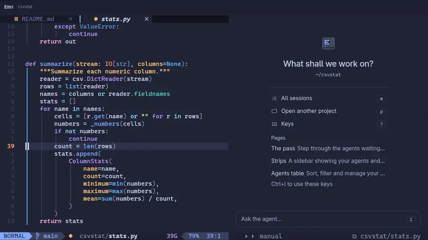
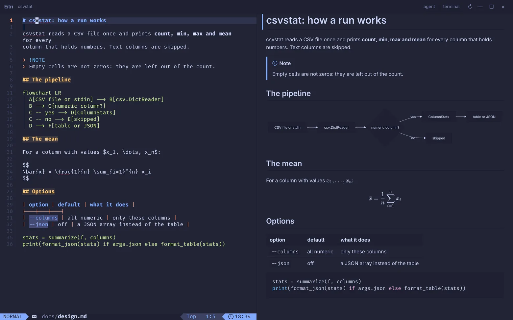
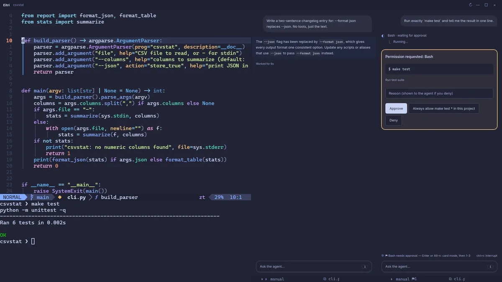

English | [简体中文](README.zh-CN.md)

<div align="center">


<h1>Eitri</h1>

<p><b>Sick of reading agent replies and Markdown in a terminal? Run your own Neovim in a GUI that renders them.</b></p>
<p>Arrange it the way you work: your own init.lua, your tmux keys, panels you build yourself.</p>

<p>
<a href="https://eitri.cc">Website</a> ·
<a href="INSTALL.md">Install</a> ·
<a href="https://eitri.cc/docs/">Docs</a> ·
<a href="https://github.com/HunterGrey-cyber/eitri/discussions">Discussions</a> ·
<a href="https://matrix.to/#/#eitri:matrix.org">Matrix</a> ·
<a href="https://t.me/eitri_cc">Telegram</a>
</p>

[](https://github.com/HunterGrey-cyber/eitri/releases/latest)
[](https://aur.archlinux.org/packages/eitri-bin)
[](LICENSE)

</div>

<p align="center">
<a href="https://eitri.cc/#workspace"></a>
<br><sub>Eitri with a real Claude Code turn, recorded on the release this README ships with (the note is typed at 4x, marked on the picture): Neovim, a Markdown preview, a chat and a terminal in one window; <code>c</code> opens what the turn changed, <code>x</code> puts a hunk back, <code>i</code> leaves a note.</sub>
</p>

Eitri is a Neovim GUI for Linux. For now it runs only on x86_64 under Wayland (X11 is untested).

If you usually keep Claude Code in one tmux pane and Neovim in another, Eitri puts that setup in one window. The editor is still your own Neovim, with your `init.lua`, plugins, LSP and keymaps. Agent replies and Markdown are laid out beside it so they are easy to read, and terminals, chats and the pages you build tile around the editor with tmux's keys (on Hyprland, sway and niri your window manager does the tiling by default).

The agent can be Claude Code, Codex or any agent that speaks ACP. Hand it a task, answer from the keyboard when it asks for approval, and press `c` after the turn to see what it changed.

## Install

```sh
curl --proto '=https' --proto-redir '=https' --tlsv1.2 -sSfL https://github.com/HunterGrey-cyber/eitri/releases/latest/download/install.sh | sh
eitri ~/path/to/project
```

You need:

- Linux on x86_64 with Wayland (X11 is untested)
- Neovim 0.11 or newer
- Claude Code, installed; Codex and ACP agents are optional

The installer builds the agent sidecar on your machine, which takes a few minutes and about 1.4 GiB of free disk while it runs. On Arch you can install [`eitri-bin`](https://aur.archlinux.org/packages/eitri-bin) or [`eitri-git`](https://aur.archlinux.org/packages/eitri-git) instead. `.deb`, `.rpm`, building from source and checking the signature before you run anything: [INSTALL.md](INSTALL.md).

## What it does

- **A workspace around your Neovim.** A real `nvim --embed` with your configuration, drawn by a fork of Neovide's GPU renderer. Around it you tile chats, terminals and pages with tmux's prefix keys (`Ctrl+b`, then a key; `Ctrl+b ?` lists them), and `:EitriTutor` walks you through them. On Hyprland, sway and niri each chat view and page is a window your window manager tiles, by default: [Compositor windows](docs/guide/compositor-windows.md). If you have never used tmux, start with [these 6 keys](docs/guide/tmux-6-keys.md).
- **Replies and Markdown you can read.** Agent replies are laid out as a document, with code in your colorscheme's colours, each edit as its own diff row, and tool calls you can fold away. The Markdown preview sits beside the file you edit and scrolls with Neovim; one line of `init.lua` turns it on.
- **Pages you build.** Your own HTML pages, or your dev server, as modules of the window (experimental): [Pages you build](docs/guide/pages.md). Eitri ships four, off until `init.lua` loads them: the Markdown preview and three pages that show your agents ([Many agents at once](docs/guide/many-agents.md)), with their source in `plugins/` to copy from. The guide also has [Write a plugin](docs/guide/write-a-plugin.md); a Recipes page with ready-made setups is on its way.<!-- TODO: link Recipes once docs/2026-11-15-recipe-shots lands -->
- **Hand it over, answer when it asks.** In a Claude Code or Codex tab, `Enter` while a turn runs puts your message into it. A call that needs your approval waits on a card you answer from the keyboard, and `Shift+Tab` moves a tab between manual, auto and bypass (an ACP tab has no manual): [Permissions](docs/guide/permissions.md).
- **See what a turn changed.** `c` lists the files that changed on disk during the agent's last turn, hunk by hunk, with a sign on the ones its own edits named. Put a hunk or a whole file back with `x` (`u` undoes it), or leave notes with `i` and send them as your next message with `s`, which shows you the message before it goes. Eitri compares its own snapshots of the project, so you don't need a git repository: [Reviewing a turn](docs/guide/turn-review.md).
- **The agents you already use.** Claude Code, Codex, or an agent you register over ACP, one per tab. Eitri runs the ones you installed and set up, and never touches your credentials: [Codex and other agents](docs/guide/agents.md).
- **Or beside your terminal nvim.** `:EitriPanel` opens the agent panel as a window of its own next to the Neovim you already run, in tmux or not: [Use it beside your own nvim](docs/guide/companion.md).
- **Configured in Lua.** `~/.config/eitri/init.lua`, read the way Neovim reads yours.

<table>
<tr>
<td width="50%"></td>
<td width="50%"></td>
</tr>
<tr>
<td><sub>The Markdown preview, beside the file you edit.</sub></td>
<td><sub>Neovim, two chats and a terminal, tiled with tmux keys.</sub></td>
</tr>
</table>

## How it differs

- **From an agent CLI in a tmux pane:** replies and Markdown are laid out as documents in a window you tile around Neovim, and the review sees the files that changed on disk during a turn, including ones a shell command changed.
- **From Claude Code's `/rewind`:** you can put back one hunk instead of the whole turn, and tell the agent why.
- **From CodeCompanion.nvim's code review:** Eitri's review is there after each turn without you starting a round, and it needs no git repository.
- **From Zed:** Eitri runs your Neovim itself, with your configuration; Zed is its own editor with a Vim mode.

The longer answers, with links to each project's own docs, are on [eitri.cc](https://eitri.cc/#differs).

## Status and limits

<!-- At the release cut: "<date>: Eitri <version> is an early release, and the ..." and the caption above gets the version from the recording. -->Eitri is an early release, and the `init.lua` API and default keys may change during 0.x. It is not yet stable enough for everyday use: that waits for real hardware and a week of daily use, not for a version number.

- It runs only on Linux x86_64 under Wayland; macOS is in progress.
- It uses more memory than native Neovide. The [known issues](docs/known-issues.md) page has the measurements and is worth reading before you file a bug.
- Eitri sends nothing anywhere on its own: no telemetry, no update check, no crash upload ([what leaves your machine](docs/known-issues.md#what-leaves-your-machine)).

Requirements in full are on [eitri.cc](https://eitri.cc/#requirements), and what comes next is on the [roadmap](https://eitri.cc/#roadmap).

## Community

- [Discussions](https://github.com/HunterGrey-cyber/eitri/discussions): questions, ideas, your setups
- [Matrix](https://matrix.to/#/#eitri:matrix.org) `#eitri:matrix.org` (English) and [Telegram](https://t.me/eitri_cc) (mostly Chinese)
- [Issues](https://github.com/HunterGrey-cyber/eitri/issues) for bugs; [CONTRIBUTING.md](CONTRIBUTING.md) for building and the tests
- The [Neovide fork](https://github.com/HunterGrey-cyber/neovide) (`neovibe-integration`) and the [agent sidecar](https://github.com/HunterGrey-cyber/verdandi) live in their own repositories

## Licence

MIT ([LICENSE](LICENSE)), except `terminal/input/`, which is Apache-2.0 (derived from Alacritty; see
its `NOTICE`). The editor pane is built on a fork of [Neovide](https://github.com/neovide/neovide) (MIT).

`shell` statically links [nvim-rs](https://crates.io/crates/nvim-rs) 0.9.2, which is **LGPL-3.0**:
each release page carries the Corresponding Source (`eitri-<version>-source.tar.gz`), and the
installed `SOURCE` file gives the recipe for relinking against a modified nvim-rs.
`THIRD-PARTY-LICENSES` carries every other notice.

The agent sidecar bundles Anthropic's Claude Agent SDK, which is not open source. No Eitri release
contains it: `eitri setup` downloads it from npm and builds the sidecar on your machine, under
Anthropic's own terms.

The logo's blue and green come from the [Neovim logo](https://neovim.io) by Jason Long (CC BY 3.0).

## How Eitri is made

Most of Eitri's code is written by coding agents, Claude Code and Codex. Hunter Grey sets the direction, chooses
between designs, reads closely where a mistake would cost the most, and steps in when something is off. Changes come
with their tests, and the full test suites run before a branch is merged.

Eitri is built for working this way. An agent works in a tab beside your editor; you read its changes where they
matter and steer it when it drifts.
