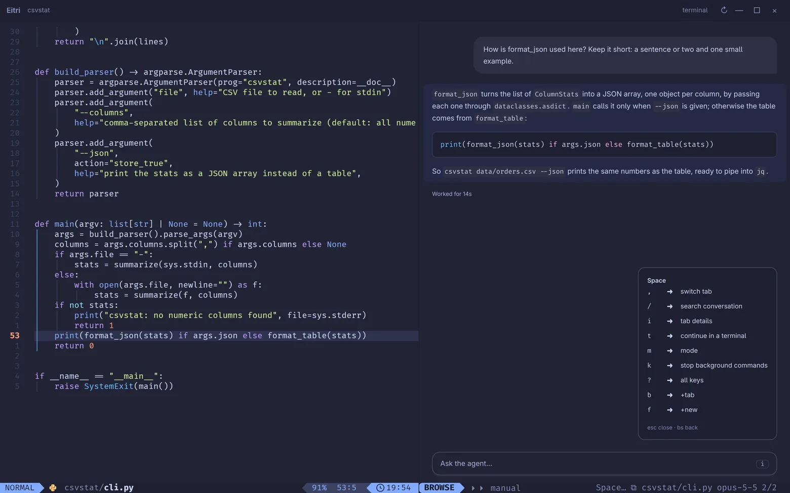

[English](README.md) | 简体中文
<!-- translated-from: README.md sha256=ae45aa75858ba011b3b3688e38d9e0ac42d41d0d43cb7fd9b18d8cca08679985 -->

<div align="center">


<h1>Eitri</h1>

<p><b>你的 Neovim，和 agent、终端、你自己做的网页平铺在一起。</b></p>

<p>
<a href="https://eitri.cc/zh/">官网</a> ·
<a href="INSTALL.zh-CN.md">安装</a> ·
<a href="https://github.com/HunterGrey-cyber/eitri/discussions">Discussions</a> ·
<a href="https://t.me/eitri_cc">Telegram</a> ·
<a href="https://matrix.to/#/#eitri:matrix.org">Matrix</a>
</p>

[](https://github.com/HunterGrey-cyber/eitri/releases/latest)
[](https://aur.archlinux.org/packages/eitri-bin)
[](LICENSE)

</div>

一个 Linux 上的 Neovim 图形前端。Eitri 是一个桌面窗口（MIT 许可），包在你自己的 Neovim 配置外面，你监督的 agent（Claude Code、Codex，或任何讲 ACP 的 agent）、终端和你自己的网页平铺在它旁边。回复是排好版的 markdown 和 diff，带一张张权限卡片，全程不用碰鼠标。

键盘驱动的平铺：分屏、标签、堆叠、浮窗和工作区，用的是 tmux 的前缀键：先按 `Ctrl+b`，再按一个键；`Ctrl+b ?` 列出全部按键。i3 的那些移动也有，是前缀之后的 Alt 组合键；在编辑器里运行 `:EitriTutor`，会带你一步步把这些键走一遍。在 Hyprland、sway 或 niri 上，聊天和页面默认是窗口，由你自己的窗口管理器平铺，这些布局键也随之关闭（`window.tiling`）。

**[eitri.cc](https://eitri.cc/zh/)** 上有截图、按键、和其他方案的对比，以及环境要求和限制。

> [!NOTE]
> **早期版本。** 已经能用，但难免有粗糙的地方，0.x 期间 `init.lua` 的 API 和默认按键还可能改动。遇到问题欢迎在
> [Issues](https://github.com/HunterGrey-cyber/eitri/issues) 或 [Discussions](https://github.com/HunterGrey-cyber/eitri/discussions)
> 告诉我们。它还没有稳定到可以日常使用：这要等真实硬件和一周的日常使用，而不是等某个版本号。



- **你自己的 Neovim。** 一个真正的 `nvim --embed`，加载你的 `init.lua`、插件、LSP 和按键映射，由 Neovide 渲染器的一个 fork 在 GPU 上绘制。
- **读得下去的回复。** markdown、按你配色高亮的代码、可以折叠的工具调用，每一次编辑单独一行 diff。
- **你监督的 agent。** Claude Code、Codex，或者你通过 ACP 注册的 agent，每个标签页一个，可以是 manual、auto 或 bypass 模式（ACP agent 没有 manual）；回合进行中按 `Enter` 会把消息插进这个回合。见 [Codex 与其他 agent](docs/guide/agents.zh-CN.md)。
- **能指给你看的 agent。** 任何标签页里的 agent 都能把一个文件打开到某一行给你看，也能读你的编辑器里现在有什么，包括未保存的改动，而且不碰你的光标：[从 agent 标签页使用你的编辑器](docs/guide/editor-tools.zh-CN.md)。
- **你自己做的页面。** Eitri 随附一个 Markdown 预览，你自己的 HTML 页面或插件也能成为窗口里的一个模块（实验性）：[你自己做的页面](docs/guide/pages.zh-CN.md)。
- **从头到尾用键盘。** 面板里用 vim 的按键，窗口用 tmux 的按键，`Ctrl+h/j/k/l` 在窗格之间移动。
- **逐个回合审阅。** 按 `c` 列出 agent 这个回合期间磁盘上改了什么；可以撤销一个 hunk，也可以把评论发回去。
- **用 Lua 配置。** `$XDG_CONFIG_HOME/eitri/init.lua`（默认 `~/.config/eitri/init.lua`），和 Neovim 读你的配置的方式一样。
- **也可以放在你自己的 nvim 旁边。** `:EitriPanel` 只把 agent 面板作为一个独立窗口，开在你终端里的 Neovim 旁边；`:EitriPage markdown` 用同样的方式打开 Markdown 预览。

**更想把 Neovim 留在终端里？** companion 模式把同一个 agent 面板作为一个独立窗口，开在你已经在用的 nvim 旁边（在 tmux 里或不在，上游 Neovide 或别的图形前端都行）。它通过 nvim 自己的 RPC socket 附着上去，把你打开的文件和选区送给 agent，agent 改完后重新加载缓冲区，并能按行号打开文件；面板一消失，它装进去的东西就全部撤掉，你的配置不会被碰。两个窗口怎么摆由你的窗口管理器决定，sway、Hyprland、niri 以及（装上随附扩展的）GNOME 还能用同样的 `Ctrl+h/j/k/l` 在它们之间移动焦点。装上 `eitri.nvim` 插件，运行 `:EitriPanel`，或者让 `eitri split` 把上游 Neovide 和面板一起打开：见[配合你自己的 nvim 使用](docs/guide/companion.zh-CN.md)。Markdown 预览也可以开在那里，不带 agent 面板：`:EitriPage markdown`（或者在 shell 里运行 `eitri page markdown`）把它作为一个独立窗口打开，跟着你正在编辑的缓冲区走：见[开在你 nvim 旁边的页面](docs/guide/companion.zh-CN.md#pages-beside-your-nvim)。

## 隐私

Eitri 自己不会向任何地方发送任何东西：没有遥测，不检查更新，也不上传崩溃报告。如果它崩溃了，会在 `$XDG_STATE_HOME/eitri/log/`（默认是 `~/.local/state/eitri/log/`）下写一份日志并告诉你位置；要不要把它附到 issue 里，由你决定。

只有在你要求的时候它才会用网络：安装脚本、`eitri setup`、`eitri sidecar check` 和 `update` 会下载东西，你点开的链接由浏览器打开。唯一的例外是 Markdown 预览：它会加载文档里指向的 `https` 图片，所以托管图片的服务器能看到你的地址。要一张都不加载：`eitri.plugin.load("markdown", { remote_images = "off" })`（见 [Markdown 预览](docs/guide/markdown-preview.zh-CN.md#图片)）。

Claude Code 和 Codex 是你自己装的程序，Eitri 用你自己的设置运行它们。它们发送什么、会不会检查更新，由它们自己的设置决定，和 Eitri 无关。

## 安装

```sh
curl --proto '=https' --proto-redir '=https' --tlsv1.2 -sSfL https://github.com/HunterGrey-cyber/eitri/releases/latest/download/install.sh | sh
eitri ~/path/to/project
```

`eitri FILE` 也可以只打开一个文件：项目从这个文件推出来，这个项目已经开着窗口时，文件交给那个窗口：见[打开文件](docs/guide/getting-started.zh-CN.md#open-a-file)。

需要 x86_64 的 Linux（Wayland），以及已安装的 Neovim 0.11 或更新版本和 Claude Code。Arch 用户可以从 AUR 安装 [`eitri-bin`](https://aur.archlinux.org/packages/eitri-bin) 或 [`eitri-git`](https://aur.archlinux.org/packages/eitri-git)。`.deb`、`.rpm`、从源码构建，以及如何验证下载的文件，见 [INSTALL.zh-CN.md](INSTALL.zh-CN.md)。

已知的限制见 [eitri.cc](https://eitri.cc/zh/#requirements)，接下来要做的见[路线图](https://eitri.cc/zh/#roadmap)。

## 社区

- 文档：https://eitri.cc/docs/zh/
- [Discussions](https://github.com/HunterGrey-cyber/eitri/discussions)：提问、建议、分享你的配置
- [Telegram 群](https://t.me/eitri_cc)（中文）和 [Matrix 房间](https://matrix.to/#/#eitri:matrix.org) `#eitri:matrix.org`（英文）
- [已知问题](docs/known-issues.zh-CN.md)：目前不支持的和还比较粗糙的地方，提 bug 之前值得先看一眼
- Bug 请发到 [Issues](https://github.com/HunterGrey-cyber/eitri/issues)；构建和测试见 [CONTRIBUTING.md](CONTRIBUTING.md)（仅有英文版）
- [Neovide fork](https://github.com/HunterGrey-cyber/neovide)（`neovibe-integration` 分支）和 [agent sidecar](https://github.com/HunterGrey-cyber/verdandi) 在各自的仓库里

## 许可证

MIT（[LICENSE](LICENSE)），`terminal/input/` 除外，它是 Apache-2.0（派生自 Alacritty；见它自己的 `NOTICE`）。编辑器窗格构建在 [Neovide](https://github.com/neovide/neovide)（MIT）的一个 fork 之上。

`shell` 静态链接了 [nvim-rs](https://crates.io/crates/nvim-rs) 0.9.2，它是 **LGPL-3.0** 许可：每个发布页面都附带对应源码（Corresponding Source，`eitri-<version>-source.tar.gz`），安装后的 `SOURCE` 文件给出了针对修改过的 nvim-rs 重新链接的方法。`THIRD-PARTY-LICENSES` 收录其余所有声明。

agent sidecar 打包了 Anthropic 的 Claude Agent SDK，它不是开源软件。没有任何一个 Eitri 发行版本包含它：`eitri setup` 会从 npm 下载它，并在你的机器上构建 sidecar，适用 Anthropic 自己的条款。

Logo 的蓝绿两色取自 Jason Long 设计的 [Neovim logo](https://neovim.io)（CC BY 3.0）。

Eitri 的开发有 Claude 协助。
