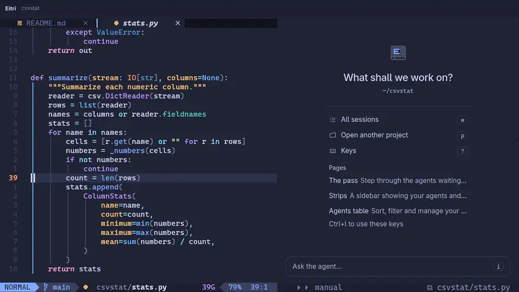
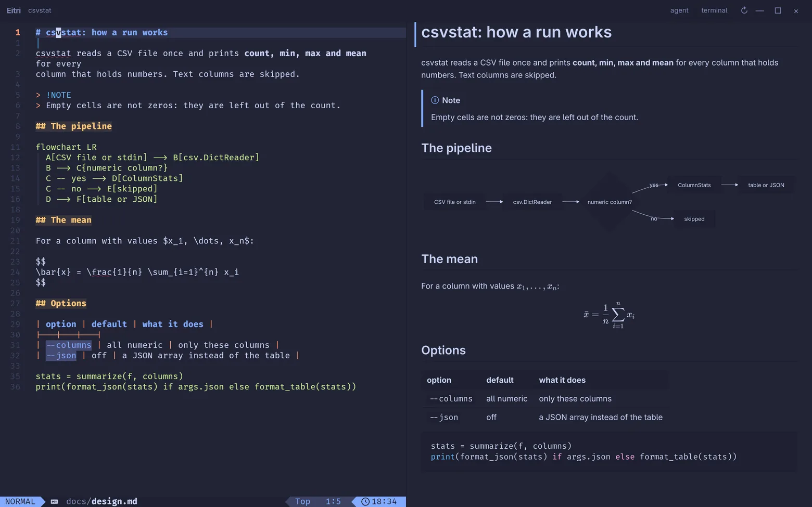
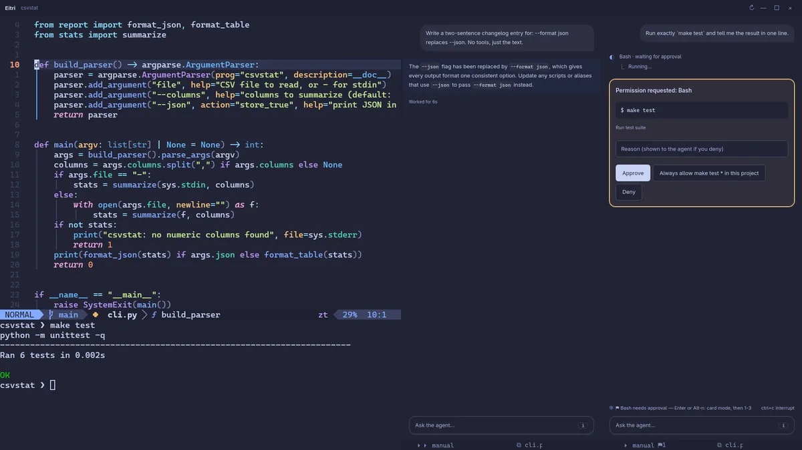

[English](README.md) | 简体中文
<!-- translated-from: README.md sha256=27aa1ce2b483267325ddd55b49c64406d4d51ff49ef85e0ad6f7b41accc8e63d -->

<div align="center">


<h1>Eitri</h1>

<p><b>受够了在终端里读 agent 回复和 Markdown？在一个能把它们渲染出来的图形窗口里，跑你自己的 Neovim。</b></p>
<p>按你的工作方式摆：你自己的 init.lua、你的 tmux 按键、你自己做的面板。</p>

<p>
<a href="https://eitri.cc/zh/">官网</a> ·
<a href="INSTALL.zh-CN.md">安装</a> ·
<a href="https://eitri.cc/docs/zh/">文档</a> ·
<a href="https://github.com/HunterGrey-cyber/eitri/discussions">Discussions</a> ·
<a href="https://t.me/eitri_cc">Telegram</a> ·
<a href="https://matrix.to/#/#eitri:matrix.org">Matrix</a>
</p>

[](https://github.com/HunterGrey-cyber/eitri/releases/latest)
[](https://aur.archlinux.org/packages/eitri-bin)
[](LICENSE)

</div>

<p align="center">
<a href="https://eitri.cc/zh/#workspace"></a>
<br><sub>录在这份 README 随附的版本上，Claude Code 是真实运行的（写批注那段加速 4 倍，画面上有标注）。一个窗口里是 Neovim、Markdown 预览、一个对话和一个终端；<code>c</code> 打开这个回合的改动，<code>x</code> 改回一个 hunk，<code>i</code> 写一条批注。</sub>
</p>

Eitri 是 Linux 上的 Neovim 图形前端，目前只支持 x86_64 和 Wayland（X11 还没测过）。

如果你平时在 tmux 里一边开 Claude Code、一边开 Neovim，Eitri 做的就是把这套搬进一个窗口。编辑器还是你自己的 Neovim，读你的 `init.lua`、插件、LSP 和按键映射。agent 的回复和 Markdown 在旁边排好版来读，终端、对话和你自己做的页面用 tmux 的按键平铺在编辑器周围（在 Hyprland、sway 和 niri 上默认交给你的窗口管理器来平铺）。

agent 可以是 Claude Code、Codex 或者任何讲 ACP 的 agent。把任务交给它，它要你批准时用键盘回答，回合结束后按 `c` 看它改了什么。

## 安装

```sh
curl --proto '=https' --proto-redir '=https' --tlsv1.2 -sSfL https://github.com/HunterGrey-cyber/eitri/releases/latest/download/install.sh | sh
eitri ~/path/to/project
```

要求：

- x86_64 Linux，Wayland（X11 还没测过）
- Neovim 0.11 或更新
- 已经装好的 Claude Code；Codex 和 ACP agent 可选

安装脚本会在你机器上构建 agent sidecar，要几分钟，构建时大约占 1.4 GiB 磁盘。Arch 上可以直接装 AUR 的 [`eitri-bin`](https://aur.archlinux.org/packages/eitri-bin) 或 [`eitri-git`](https://aur.archlinux.org/packages/eitri-git)。`.deb`、`.rpm`、从源码构建，以及运行前先验签，见 [INSTALL.zh-CN.md](INSTALL.zh-CN.md)。

## 能做什么

- **围着你的 Neovim 的工作环境。** 编辑器是一个真正的 `nvim --embed`，加载你的配置，用 Neovide GPU 渲染器的一个 fork 来画。对话、终端和页面平铺在它周围，用的是 tmux 的前缀键：先按 `Ctrl+b`，再按一个键；`Ctrl+b ?` 列出全部按键。`:EitriTutor` 会带你把这些键练一遍，系统语言是中文时它讲中文。在 Hyprland、sway 和 niri 上，每个对话视图和页面默认是一个由窗口管理器平铺的窗口：[合成器窗口](docs/guide/compositor-windows.zh-CN.md)。没用过 tmux 的话，先看[这 6 个键](docs/guide/tmux-6-keys.zh-CN.md)。
- **回复和 Markdown 读起来舒服。** agent 的回复排成文档，代码用你配色里的颜色，每次编辑单独一行 diff，工具调用可以折起来。Markdown 预览就在你编辑的文件旁边，跟着 Neovim 滚动；`init.lua` 里加一行就能打开。
- **自己做的页面（实验性）。** 你自己的 HTML 页面或者开发服务器，可以变成窗口里的一个模块：[你自己做的页面](docs/guide/pages.zh-CN.md)。Eitri 自带四个，`init.lua` 里加载之前都不启用：Markdown 预览，和三个显示 agent 状态的页面（[同时用很多 agent](docs/guide/many-agents.zh-CN.md)）。源码在 `plugins/` 里，可以照着改。指南里还有[写一个插件](docs/guide/write-a-plugin.zh-CN.md)；给几类人准备现成配置的「配方」一页正在写。<!-- TODO: link Recipes once docs/2026-11-15-recipe-shots lands -->
- **交给它，它问时回答。** 在 Claude Code 或 Codex 标签页里，回合进行中按 `Enter` 可以插话。需要你批准的调用会停在一张卡片上，用键盘回答。`Shift+Tab` 在 manual、auto 和 bypass 三种模式之间切换（ACP 标签页没有 manual）：[权限与信任](docs/guide/permissions.zh-CN.md)。
- **看一个回合改了什么。** 按 `c` 列出 agent 上一个回合期间磁盘上变了的文件，逐个 hunk 展开；agent 自己的编辑调用点过名的文件会带标记。`x` 把一个 hunk 或整个文件改回去（`u` 撤销这次改回）；`i` 写批注，`s` 把批注作为下一条消息发出去，发之前先给你看一遍。Eitri 比对的是它自己给项目拍的快照，所以不需要 git 仓库：[审阅一个回合](docs/guide/turn-review.zh-CN.md)。
- **用你已经装好的 agent。** Claude Code、Codex，或者你通过 ACP 注册的 agent，每个标签页一个。Eitri 运行的是你自己装好并设置好的那些，不碰你的凭据：[Codex 与其他 agent](docs/guide/agents.zh-CN.md)。
- **也可以放在终端里的 nvim 旁边。** `:EitriPanel` 把 agent 面板单独开成一个窗口，放在你已经在用的 Neovim 旁边，用不用 tmux 都行：[配合你自己的 Neovim 使用](docs/guide/companion.zh-CN.md)。
- **用 Lua 配置。** 配置文件是 `~/.config/eitri/init.lua`，读法和 Neovim 读你的配置一样。

<table>
<tr>
<td width="50%"></td>
<td width="50%"></td>
</tr>
<tr>
<td><sub>Markdown 预览，就在你编辑的文件旁边。</sub></td>
<td><sub>Neovim、两个对话和一个终端，用 tmux 的按键平铺。</sub></td>
</tr>
</table>

## 和别的做法比

- **tmux 里开一个 agent CLI 窗格：** 这样完全能用。Eitri 多出来的是：回复和 Markdown 排成文档，放在一个你围着 Neovim 平铺的窗口里；回合审阅看的是这个回合期间磁盘上变了的文件，shell 命令改的也算。
- **Claude Code 的 `/rewind`：** 在 Eitri 里你可以只改回一个 hunk，不用撤掉整个回合，还能告诉 agent 为什么。
- **CodeCompanion.nvim 的代码审阅：** Eitri 的回合审阅每个回合之后都在，不用你先开始一轮，也不需要 git 仓库。
- **Zed：** Eitri 跑的就是你的 Neovim 和你的配置；Zed 是它自己的编辑器，带一个 Vim 模式。

更细的回答，以及各项目自己文档的链接，见 [eitri.cc](https://eitri.cc/zh/#differs)。

## 现状与限制

<!-- 发布时改成「<日期>：Eitri <版本> 是早期版本，……」，上面的录像说明填录像的版本。 -->Eitri 0.4.0 是早期版本，还不稳定，会有粗糙的地方；0.x 期间 `init.lua` 的 API 和默认按键都可能改。

- 只支持 x86_64 Linux 和 Wayland，macOS 版在做。
- 内存占用比原生 Neovide 多，具体数字在[已知问题](docs/known-issues.zh-CN.md)里。提 bug 之前值得先看一眼那一页。
- Eitri 自己不往任何地方发东西：没有遥测，不检查更新，不上传崩溃报告（[什么会离开你的机器](docs/known-issues.zh-CN.md#什么会离开你的机器)）。

完整的环境要求见 [eitri.cc](https://eitri.cc/zh/#requirements)，接下来要做的见[路线图](https://eitri.cc/zh/#roadmap)。

## 社区

- [Discussions](https://github.com/HunterGrey-cyber/eitri/discussions)：提问、建议、晒你的配置
- [Telegram 群](https://t.me/eitri_cc)（中文为主）和 [Matrix 房间](https://matrix.to/#/#eitri:matrix.org) `#eitri:matrix.org`（英文）
- Bug 发到 [Issues](https://github.com/HunterGrey-cyber/eitri/issues)；构建和测试见 [CONTRIBUTING.md](CONTRIBUTING.md)（只有英文）
- [Neovide fork](https://github.com/HunterGrey-cyber/neovide)（`neovibe-integration` 分支）和 [agent sidecar](https://github.com/HunterGrey-cyber/verdandi) 在各自的仓库里

## 许可证

MIT（[LICENSE](LICENSE)），`terminal/input/` 除外，它是 Apache-2.0（派生自 Alacritty，见它自己的 `NOTICE`）。编辑器窗格基于 [Neovide](https://github.com/neovide/neovide)（MIT）的一个 fork。

`shell` 静态链接了 [nvim-rs](https://crates.io/crates/nvim-rs) 0.9.2，它的许可证是 **LGPL-3.0**：每个发布页面都附带对应源码（Corresponding Source，`eitri-<version>-source.tar.gz`），安装后的 `SOURCE` 文件写了怎样针对修改过的 nvim-rs 重新链接。其余所有声明在 `THIRD-PARTY-LICENSES` 里。

agent sidecar 打包了 Anthropic 的 Claude Agent SDK，它不是开源软件。Eitri 的任何发布文件里都没有它：`eitri setup` 从 npm 下载它，在你的机器上构建 sidecar，适用 Anthropic 自己的条款。

Logo 的蓝绿两色取自 Jason Long 设计的 [Neovim logo](https://neovim.io)（CC BY 3.0）。

## Eitri 是怎么做出来的

Eitri 的大部分代码由编程 agent（Claude Code 和 Codex）编写。Hunter Grey 定方向，在几种设计之间做选择，在出错代价最大的地方仔细看，发现不对就介入。改动带着测试一起写。

Eitri 就是为这种工作方式做的。agent 在编辑器旁边的标签页里干活；你在要紧的地方看它改了什么，它跑偏了就把它拉回来。
