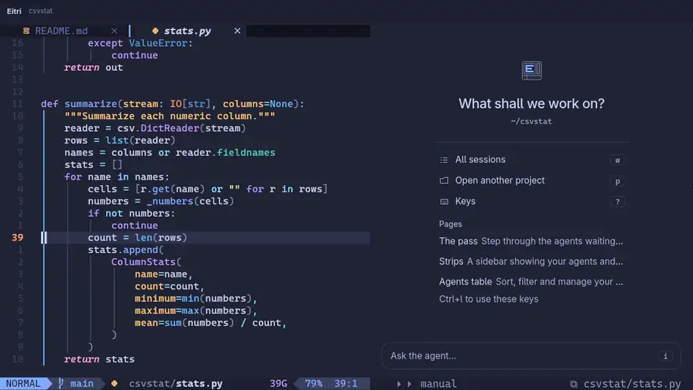

[English](README.md) | 简体中文
<!-- translated-from: README.md sha256=36d1d0e68abed9e4fa4aeed9b580d1be9ef2d5346e36e5a34768621332b47b95 -->

<div align="center">


<h1>Eitri</h1>

<p><b>你自己的 Neovim，像 tmux 一样平铺，放在一个能渲染的图形窗口里。</b></p>
<p>Neovim、编程 agent、渲染好的 Markdown、终端，还有你自己做的网页面板，平铺在一个窗口里，用 vim 和 tmux 的键来操作。</p>

<p>
<a href="https://eitri.cc/zh/">官网</a> ·
<a href="https://eitri.cc/docs/zh/">文档</a> ·
<a href="INSTALL.zh-CN.md">安装</a> ·
<a href="https://github.com/HunterGrey-cyber/eitri/discussions">Discussions</a>
</p>

[](https://github.com/HunterGrey-cyber/eitri/releases/latest)
[](https://aur.archlinux.org/packages/eitri-bin)
[](LICENSE)

</div>

<p align="center">
<a href="https://eitri.cc/zh/#workspace"></a>
<br><sub>左边是你的 Neovim，右边是 Claude Code 对话：就选中的代码提问，批准改动，审阅这个回合，改回一个 hunk。</sub>
</p>

```sh
curl --proto '=https' --proto-redir '=https' --tlsv1.2 -sSfL https://github.com/HunterGrey-cyber/eitri/releases/latest/download/install.sh | sh
eitri ~/path/to/project
```

需要 x86_64 Linux 和 Wayland、Neovim 0.11 或更新，以及你自己装好的 Claude Code、Codex 或 ACP agent。
Arch 上装 AUR 的 [`eitri-bin`](https://aur.archlinux.org/packages/eitri-bin)。安装包和从源码构建：[INSTALL.zh-CN.md](INSTALL.zh-CN.md)。

## 为什么试试

- Eitri 跑的是你自己的 Neovim，读你的 `init.lua`、插件、LSP 和按键映射，用 Neovide 渲染器的一个 fork 来画。
- agent 的回复排成文档来读，每次编辑是一行，带着它的 diff。
- Markdown 预览就在你编辑的文件旁边，跟着 Neovim 滚动。
- 对话、终端和页面用 tmux 的按键平铺在编辑器周围；在 Hyprland、sway 和 niri 上，它们是你合成器里的窗口。
- Claude Code、Codex 和 ACP agent 各开标签页，`Ctrl+b u` 跳到等你最久的那个。
- 回合结束后，`c` 列出变了的每个文件，`x` 改回一个 hunk，有没有 git 都行。
- `:EitriPanel` 把 agent 面板开在你在终端里已经跑着的 Neovim 旁边。

第一次用？[入门](https://eitri.cc/docs/zh/getting-started/)从第一次启动讲到做完一个回合，`:EitriTutor` 带你练按键。

## 限制

Eitri 0.4.0 是早期版本，还不稳定：0.x 期间 `init.lua` 的 API 和默认按键都可能改。
目前只支持 x86_64 Linux（macOS 版在做），内存占用比原生 Neovide 多。
安装脚本会在你机器上构建 agent sidecar（几分钟，大约 1.4 GiB 空闲磁盘）。
Eitri 自己不往任何地方发东西（[什么会离开你的机器](docs/known-issues.zh-CN.md#什么会离开你的机器)）。其余见[已知问题](docs/known-issues.zh-CN.md)。

## 更多

- [文档](https://eitri.cc/docs/zh/)：指南、按键、配置、更新记录
- [和别的做法比](https://eitri.cc/zh/#differs)：claudecode.nvim、CodeCompanion、avante.nvim、Zed
- [Discussions](https://github.com/HunterGrey-cyber/eitri/discussions)、[Telegram 群](https://t.me/eitri_cc)（中文为主）、[Matrix](https://matrix.to/#/#eitri:matrix.org)、[Issues](https://github.com/HunterGrey-cyber/eitri/issues)、[CONTRIBUTING.md](CONTRIBUTING.md)（英文）

## Eitri 是怎么做出来的

大部分代码由编程 agent（Claude Code 和 Codex）编写。Hunter Grey 定方向，在几种设计之间做选择，在出错代价最大的地方仔细看，发现不对就介入。

## 许可证

MIT（[LICENSE](LICENSE)），`terminal/input/` 除外（Apache-2.0，派生自 Alacritty）。`shell` 静态链接了
[nvim-rs](https://crates.io/crates/nvim-rs) 0.9.2（LGPL-3.0）：每个发布都附带对应源码（`eitri-<version>-source.tar.gz`），
安装后的 `SOURCE` 文件写了怎样重新链接。agent sidecar 用到 Anthropic 的 Claude Agent SDK，它不是开源软件，Eitri 从不分发它：
`eitri setup` 下载它，在你的机器上构建 sidecar。其余声明见 `THIRD-PARTY-LICENSES`。Logo 的颜色取自 Jason Long 设计的
[Neovim logo](https://neovim.io)（CC BY 3.0）。
