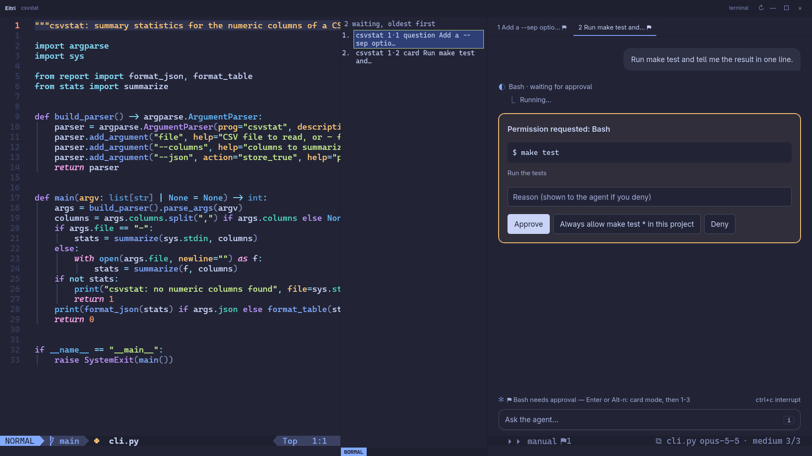

English | [简体中文](write-a-plugin.zh-CN.md)

# Write a plugin

A plugin is how you put a tool of your own next to the editor: a board of your agents laid out the way you think
about them, say, or a page that runs your project's own scripts and shows what they print. The three agent pages that ship with Eitri ([Many agents at once](many-agents.md)) are ordinary plugins.
They use the same `agents` capability described below and nothing a plugin of yours cannot use.

[Pages you build](pages.md) is the short introduction, with a first plugin you can copy. This page is the reference:
what a plugin may declare, how its page talks to Eitri, every call and event of the `agents` capability, and what
stays stable between releases. It ends with a complete page that lists the agents waiting for you.

**Plugins are experimental.** Anyone may write and share one, and the format is open to that, but it is 0.x: read
[What stays stable](#what-stays-stable) before you build on it.

## What a plugin is

- **A directory** with an `eitri-plugin.toml` (the manifest) and a small static web site. Eitri shows the site's
  entry page as a module of the window, `lua:<id>`, beside the editor, the chats and the terminals.
- **A page in a web view.** The page runs in WebKitGTK at `eitri-plugin://<id>/` under a strict content security
  policy: scripts and style sheets only from the site, no inline script, no `eval`, network requests only to the
  origins its manifest lists ([What the page runs in](pages.md#what-the-page-runs-in) has the details).
- **A closed list of powers.** The page reaches Eitri only through `window.eitriPlugin`, and only for the
  capabilities its manifest declares. A call that needs a capability the manifest does not list is refused with
  `not_declared`.
- **No native code in Eitri.** A plugin that needs a program declares it as a task. Eitri starts it as a separate
  process, without a shell: the program must be a file inside the plugin's directory, and it runs in the task's `cwd`,
  inside one of the plugin's roots. Its output goes to the page line by line.
  Nothing a plugin brings is ever loaded into Eitri's own process.
- **Loaded by `init.lua`.** `eitri.plugin.load("<id>")` loads it by name from
  `~/.local/share/eitri/plugins/<id>/` (or the other places [Plugins](configuration.md#plugins) lists), and
  `eitri.plugin.load("/path/to/dir")` from anywhere. `:Eitri plugin load <id>` loads one into the running window
  for this run only.

## Trust, today

There is no consent screen yet. **Loading a plugin is the grant:** the `eitri.plugin.load` line in your own
`init.lua` gives the plugin every power its manifest lists, and a plugin with tasks runs its programs as you, with
your files and your network. So the rule today is to read the code before you load it, as you would before running
a script someone sent you. Eitri records each plugin's list of capabilities under
`~/.local/state/eitri/plugins/<id>/` and says so at the next start when the list changes; it asks nothing.

A copy in your own data directory comes before the copy Eitri ships, which is how you change or replace a shipped
plugin: copy `/usr/share/eitri/plugins/agents-top/` to `~/.local/share/eitri/plugins/agents-top/`, edit it, and the
next window loads yours. The shipped copy has no special standing, and nothing checks a plugin's files against
anything. Every load prints which directory it used in the terminal you started Eitri from:

```text
[plugin agents-top] loaded /home/you/.local/share/eitri/plugins/agents-top (user data directory)
```

## The manifest

```toml
id = "waiting-list"          # the name you load it by
title = "Who waits"          # the module's chip and the tray
protocol = 1
site = "site"                # the directory of the page's files, relative to the plugin
entry = "index.html"         # the page inside it
capabilities = ["agents", "layout.focus"]
```

A key that a table does not know, or a value it does not take, stops the load; Eitri lists it when it starts, naming
the key.

| key | what it holds |
|---|---|
| `id` | lower-case letters, digits and `-`, at most 40 characters, no `-` at either end. Loaded by name, it must equal the directory's name |
| `title` | the name on the module's chip |
| `summary` | optional: one line, at most 80 characters, shown beside the title where Eitri offers to load the plugin (the empty tab's Pages list) |
| `protocol` | `1`, the only version there is |
| `site`, `entry` | relative paths, no `..` |
| `capabilities` | the powers the page may use, from the table below |
| `[settings.<name>]` | an option of `eitri.plugin.load`, with a `kind`: `bool` (a `default` of `true` or `false`), `choice` (`values`, one to eight words, and a `default` among them), `int` (`min`, `max` and an optional `default`; without one the setting is unset until `init.lua` gives it) or `dir` (a path, created if missing). A name is lower-case, at most 32 characters, and not `plugin`, `key` or `position` |
| `[module]` | `start` (`"shown"` or `"hidden"` at a first launch), `at` (an [open rule](configuration.md#where-a-new-module-opens) place), `size` (a share, or `"<n>px"`), `focus` (whether it takes the keys when it opens), `key` (a module key of its own, which yields to any key you or your tmux configuration already use) and `shown_while = "agents-wait"` (see below) |
| `[roots]` | the directories `editor.open`, `editor.assist` and tasks may touch, written with `${plugin}` or a `dir` setting |
| `[tasks.<name>]` | `argv` (its first word `${plugin}/<path>`, a program inside the plugin), `cwd` (inside a root) and `timeout_secs` (`0` for none, at most a day) |
| `[vars.<name>]` | a value the page passes to a task: `chars` (`"lower-digit-dash"`, `"lower-digit"` or `"digit"`) and `max_len` (1 to 256); a value never starts or ends with `-` |
| `[net]` | `origins` (`https://host[:port]` the page may fetch from) and `images` (`"https"`, `"off"`, or a choice setting with those two values) |
| `[follow]` | `filetypes` (one to sixteen) the page follows in the editor, and `auto_show` (a bool setting) |
| `[commands.<Name>]` | at most eight Neovim commands that show, toggle or hide the page (`does = "show"`, `"toggle"` or `"hide"`) |
| `[page]` | `handoff = true` when the page hands its state to the page that replaces it in another window |
| `[window]` | `root`, `title`, `focus` and `layout`: the window Eitri opens when started in that directory is the plugin's own |

`[module] shown_while = "agents-wait"` needs the `agents` capability and `start = "hidden"`. Eitri then shows the
module whenever an agent waits for you (or a round runs) and hides it again when none does, without moving the keys.
The pass uses it.

## Capabilities

Each capability admits a fixed set of calls and events. `host.hello` and `keys.declare` need none, and neither do
the `focus`, `keys_config` and `theme` events. `page.saved` and `page.ready`, and the `host.save` event, need no
capability either: `[page] handoff = true` admits them, for a page that hands its state to the page replacing it in
another window.

| capability | calls | events | what the page can then do |
|---|---|---|---|
| `state` | `state.read`, `state.write`, `log.append`, `log.read` | | keep JSON values by key (at most 64 keys, 192 KiB a value) and append to logs, under `~/.local/state/eitri/plugins/<id>/` |
| `layout.focus` | `layout.focus` | | give the keys to the editor, or take them (`target` `"editor"` or `"self"`) |
| `editor.open` | `editor.open` | | open a file inside a root in the editor, at a line and column |
| `editor.assist` | `editor.assist`, `editor.assist_clear` | | turn diagnostics and inlay hints on or off for files under a root |
| `tasks` | `task.start`, `task.cancel` | `task.output`, `task.exit` | run the plugin's own `[tasks]` and read their output |
| `net` | | | fetch from the `[net]` origins, and with `[net] images = "https"` load `https` images from any host; nothing else leaves the page |
| `editor.follow` | `editor.follow`, `editor.reveal`, `editor.jump`, `editor.open_link` | `editor.view`, `editor.text`, `editor.closed` | follow the buffer you edit, scroll it and move its cursor |
| `editor.commands` | | | define the `[commands]` in Neovim |
| `editor.cwd` | `editor.cd` | | change the editor's directory, in the plugin's own window only |
| `editor.buffers` | `editor.preload`, `editor.modified`, `editor.reload`, `editor.diff` | | load, list, reload and diff buffers under a root |
| `terminal.cwd` | `terminal.at` | | start the terminal in a directory under a root, in the plugin's own window only |
| `agents` | `agents.watch`, `agents.focus`, `agents.new`, `agents.select`, `agents.round`, `agents.stop` | `agents.row`, `agents.gone`, `agents.reset`, `agents.selection`, `agents.round` | see every agent tab of every Eitri window and act on them (below) |

`agents` and `net` cannot be declared together. A page that can read your agents cannot also reach the network, so
nothing it learns about them can leave the machine through it; the load is refused with
`agents and net cannot be declared together`.

A page window beside your own Neovim (`eitri page <id>`) honours only `editor.follow`, `editor.commands`,
`editor.open`, `state` and `net`, and refuses a plugin that declares anything else or has a `[window]` table.

## The bridge

`window.eitriPlugin` is the page's one connection to Eitri:

- `call(verb, args)` returns a promise of the call's result. It rejects with an `Error` whose `code` says why and
  whose `message` says it in words.
- `on(event, fn)` calls `fn` with the event's data each time the event arrives.

Call `host.hello` first. Its result holds the page's `settings`, the `capabilities` the manifest declared, the
`theme`, the window's `prefix` and `timeoutlen`, `keys_settings` for the keys kit, `module_key`, `own_window`, and the
runs of its tasks that are still going. Every event but `theme` waits for it, and so does `keys.declare`. A page
that reloads is a new document and says hello again.

A message may be at most 256 KiB (a `page.saved` message 1 KiB more, for what wraps its state). The error codes are `bad_request` (an unknown verb, an unknown or missing argument,
a value out of range), `not_declared`, `not_own_window`, `outside_roots`, `no_such_task`, `bad_var`, `busy`,
`editor_unavailable`, `editor_timeout`, `too_large`, `io`, and for `agents` also `disabled`, `gone`, `no_window`,
`no_gesture` and `refused`. Every call is answered within its deadline (five seconds for the editor and the agents),
so a page needs no timer of its own.

Colours and fonts arrive as `--nv-*` CSS variables, and the keys kit at `/.eitri/keys.js` gives the page the keys
every plugin page shares; [Pages you build](pages.md#what-the-page-runs-in) describes both.

## The `agents` capability

Every Eitri window on your machine publishes one row per agent tab: who it is, what state it is in, since when,
whether it waits for you. A page with `agents` reads all of them, from every window and every project, and can take
you to one. That is enough to build your own view of your agents, with your own order, grouping and keys.

What it cannot do:

- **Nothing answers for you.** No call, row or event answers a permission card, a question or the trust question.
  Moving to a card never presses a key in it; you answer in the chat, with the chat's keys.
- **No conversation text.** A row carries no prompt, reply, tool input, path or failure reason. The label is the one
  piece derived from a prompt (the title the chat gives the tab, cut to 40 characters).
- **Every call but `agents.watch` needs your gesture.** The page's module must hold the keys, and a key press, a
  button press or a touch must have reached the page less than a second before the call. A page's own script cannot
  make such an event, so a page cannot move you around on its own. `agents.new` is also refused within a second of
  the previous one.
- **`agents` and `net` exclude each other**, as above.

### The calls

| call | arguments | result | refused with |
|---|---|---|---|
| `agents.watch` | `{}` | the whole view (below) | `disabled` (agents are off in this window), `busy` (no view within 5 s), `io` (the reader failed) |
| `agents.focus` | `{id, card_first?}` | `{}` | `gone` (the row left), `no_gesture`, `refused`, `busy`, `disabled` |
| `agents.new` | `{project}`, a project key from the view's `projects` | `{}` | `no_window` (no window of that project runs), `refused` (within a second of the last one, or the window refused), `no_gesture`, `busy`, `disabled` |
| `agents.select` | `{key}` | `{}` | `gone` (no row has that key), `refused` (the shared selection could not be written), `no_gesture`, `busy`, `disabled` |
| `agents.round` | `{op, key?}`, `op` is `"start"`, `"next"` or `"leave"` | `{}` | `refused` (before the page's `agents.watch` was answered, a `start` at a row that does not wait, nothing waits, or the round could not be written), `gone` (the key's row left), `no_gesture`, `busy`, `disabled` |
| `agents.stop` | `{id}` | `{}` | `gone`, `refused` (nothing runs there), `no_gesture`, `busy`, `disabled` |

Every call also answers `bad_request` for an argument it does not know, and `not_declared` without the capability.

- **`agents.watch`** answers the view as it is now; asked again, it answers again. Eitri sends the answer before any
  `agents.*` event for that page, so the events that follow are all newer than the view, and none is lost in between.
- **`agents.focus`** brings the row's chat forward, in whichever window it is, with its card in front when
  `card_first` is `true` (default `false`). On GNOME the window comes forward because your key press asked for it.
- **`agents.new`** opens a new agent tab in a running window of that project.
- **`agents.select`** moves the selection every agents page shares, in every window.
- **`agents.round`** walks the agents that wait, oldest first, as `<prefix> u` does. `start` begins at `key` (or the
  oldest wait), or moves a running round there, and brings that chat forward with the card first; `next` goes on to
  the next one (with no round running it starts one; with no stop left the round ends where it is, and the call
  succeeds); `leave` ends the round and goes back to where it started.
- **`agents.stop`** brings the row's chat forward and asks `Stop this turn? (y/n)` there. Nothing stops until you
  answer `y` in the chat.

### The events

Events reach a page only after its `host.hello` and its `agents.watch` were answered, and only while its module is on
screen. A page that could not hear some changes (it was off screen, or loading) gets one `agents.reset` with the
whole view before anything else.

| event | data |
|---|---|
| `agents.row` | a row that is new or changed (the row itself: `data.id`, not `data.row.id`) |
| `agents.gone` | `{id, key, why}` for a row that left |
| `agents.reset` | the whole view, to replace everything the page holds |
| `agents.selection` | the shared selection, or `null` |
| `agents.round` | the round, or `null` |

Keep rows by `key` when they have one: a tab that moves to another window comes back as a new `id` with the same
`key`, and its `agents.gone` for the old `id` may arrive after the new row. Remove a row on `agents.gone` only when the
`id` you hold for that key is the one that left.

A page that declares `agents` also gets `window.eitriAgents` before its own script runs: a row store that applies
these events in that way, a glyph and a word for every state, and the keys of the
[shared grammar](many-agents.md#the-shared-grammar) (`j`, `k`, `Enter`, `c`, `x`, `/`, `Esc`), so a page of yours can
behave like the bundled three with a few lines. The example at the end uses the bridge directly instead, so you can
see each call.

### The rows

The whole view and each line of `eitri agents --watch` carry `"v": 1`; a row itself does not (the example below has no
`v`), and neither does the payload of a page event, except `agents.reset`'s, which is the whole view. A reader must ignore fields it does not know and map a state it
does not know by its `class`. One row:

```json
{
  "id": "a3f09c1d2e4b5f60.7",
  "key": "k-5c1e0b9a7d3f2e18",
  "agent": "claude",
  "project": { "key": "9b2c4e7a10f3d856", "name": "eitri" },
  "window": { "instance": "a3f09c1d2e4b5f60", "name": "1", "focused": true },
  "number": 3,
  "label": "close question",
  "label_from": "title",
  "shown": false,
  "state": "card",
  "class": "needs",
  "since": 1793865600123,
  "needs": { "cards": 1, "questions": 0, "trust": false },
  "waiting_since": 1793865600123,
  "unread": false,
  "tool": "Bash",
  "background": { "calls": 0, "shells": 0, "monitors": 0, "agents": 0, "other": 0 },
  "queued": 0,
  "mode": "manual",
  "ended_how": null,
  "moving": false
}
```

| field | meaning |
|---|---|
| `id` | `<instance>.<tab>`; valid while the row exists; the argument of `focus` and `stop` |
| `key` | `k-` and 16 hex digits, the tab's own, kept when the tab moves to another window or is resumed |
| `agent` | `claude`, `codex` or `acp:<name>` |
| `project` | `key` (16 hex digits, no path) and `name` (the folder's name, cut to 40 characters) |
| `window` | `instance` (random per process start), `name` (`1`, `2`, `u` for an unpaired window, `c1`..`c9` for compositor chat windows, `companion`), `focused` |
| `number` | the number on the tab strip of that window (not global) |
| `label`, `label_from` | at most 40 characters; from `rename`, `title`, `session` or `new` |
| `shown` | the tab is the active tab of a chat that is on screen |
| `state`, `class` | below |
| `since` | when the row entered its state, in milliseconds since the epoch of the writing process's clock |
| `waiting_since` | when the oldest card, question or trust question was first seen, or `null`; the round orders by it |
| `needs` | counts of cards and questions, and whether a trust question waits (a tab can hold a card and a question) |
| `unread` | a turn finished while the chat was not on screen |
| `tool` | the open tool call's name (or the oldest card's), never its input |
| `background` | `calls` is the total; the four counts by kind can all be 0 while `calls` is not |
| `queued` | messages typed and waiting for the turn to end |
| `mode` | `manual`, `auto` or `bypass` |
| `ended_how` | `closed`, `stopped`, `unavailable`, `start_failed` or `tripped`; never a reason text |
| `moving` | the tab is in the middle of moving to another window |

The states, in the order that decides which one a row has (the first that holds wins):

| state | class | glyph | when |
|---|---|---|---|
| `card` | needs | `⚑` | a permission card or a tool card waits |
| `question` | needs | `?` | a question set waits |
| `trust` | needs | `?` | a start waits for the trust answer |
| `failed` | ended | `✕` | the tab could not start, or its session died unasked |
| `ended` | ended | `✕` | the session closed or you stopped it, and the tab is still open |
| `running` | working | `●` | a turn runs |
| `background` | working | `◌` | no turn runs, background work does |
| `starting` | working | `…` | the session is being opened |
| `done` | quiet | `•` | idle, and a turn finished while the chat was not on screen |
| `idle` | quiet | `·` | a live session with nothing running and nothing unread |
| `new` | quiet | (blank) | a tab with no session yet |

The whole view, which is what `eitri agents --json` prints and `agents.watch` answers:

```json
{ "v": 1, "at": 1793865600200, "enabled": true, "projects": [ ... ], "rows": [ ... ],
  "selection": { "key": "k-…", "by": "a3f09c1d2e4b5f60", "at": 1793865600100 } | null,
  "round": { "from": { "instance": "a3f09c1d2e4b5f60", "module": "…", "tab": null }, "current": "k-…",
             "visited": [ ... ], "started_at": 1793865500000, "at": 1793865600100 } | null }
```

`projects` lists every project that has a running window, `{key, name}`, including one whose windows hold no tab, so a
page can offer `new` there. Rows come ordered by project name and key, window name and instance, and number. The first
line of `--watch` is the whole view, as `--json` prints it (no `type`); every line after it wraps one change in an
envelope with `v` and `type`:

```json
{ "v": 1, "type": "row",  "row": { ... } }
{ "v": 1, "type": "gone", "id": "a3f09c1d2e4b5f60.7", "key": "k-5c1e0b9a7d3f2e18", "why": "closed" }
{ "v": 1, "type": "reset", "view": { ... } }
{ "v": 1, "type": "selection", "selection": { ... } | null }
{ "v": 1, "type": "round", "round": { ... } | null }
```

A page does not get these envelopes. Its callback receives the payload alone, whose names are the ones inside the
envelope: for `agents.row` the row itself (`event.id`, not `event.row.id`), for `agents.gone` `{id, key, why}`, for
`agents.reset` the whole view (this one has `v`), for `agents.selection` the selection or `null`, for `agents.round`
the round or `null`.

`why` is `closed` (the tab), `moved` or `window` (its process ended, or turned the layer off). A process publishes at
most 64 rows and 64 KiB: past 64 rows it publishes the first 64 by tab number, and past 64 KiB it leaves out the
rows with the highest tab numbers until the file fits.

## The keys kit: `window.eitriKeys`

Every plugin page can load the keys kit from `/.eitri/keys.js`, and a page that declares `agents` gets it before its
own script runs. It gives the page the keys every plugin page shares and runs the page's own. The page calls
`host.hello` itself and hands the kit what it needs from the reply:

```js
const hello = await window.eitriPlugin.call("host.hello");
const remove = await window.eitriKeys.install({
  rows: [{ action: "list.open", keys: ["<CR>"], context: "my page", desc: "open the selected item" }],
  run(action, event) { if (action === "list.open") { openSelected(); return true; } return false; },
  initial: { timeoutlen: hello.timeoutlen, hasKeys: true, prefix: hello.prefix, settings: hello.keys_settings },
});
```

- **`install(options)`** declares the rows to Eitri (`keys.declare`, so `?` and Eitri's key sheet list them) and
  returns a promise of a function that removes the installation. Installing again replaces the earlier
  installation. `run(action, event)` is called when one of your keys is pressed and returns `true` when it handled
  it. A row is `{action, keys, context, desc}`: `action` lower-case letters, digits and `_.-`, at most 40 characters;
  one to ten keys in Vim's notation (`j`, `gg`, `<C-d>`, `<CR>`, `<Esc>`); `context` at most 40 characters and `desc`
  at most 80. The keys Eitri keeps (the prefix, `Ctrl+h/j/k/l`, `Ctrl+=`, `Ctrl+-`, `Ctrl+0`, `F11`, any `Ctrl+Shift`
  or Super chord) are refused, and so is a key two of your actions share.
- **The shared rows come first:** scrolling (`j`/`k`, `d`/`u`, `Ctrl+f`/`Ctrl+b`, `gg`/`G` and more), history
  (`H`/`L`), `[[`/`]]`, find (`/`, `n`, `N`), hints (`f`), the key sheet (`?`), `Esc`, and visual mode (`v`, `V`). A row of yours with the same `action` replaces that shared row, and a key one of your
  rows uses is taken away from the shared rows, so your `j` wins over scrolling.
- **The other options:** `targets()` (what `f` labels, besides links and controls), `labels` (the words of the `?`
  sheet and the status line, for a page in another language), `find` (`{root, exclude}`: what `/` searches),
  `bottom()` (where `G` goes), `onJump(when)` (told before and after the kit's own jumps, for a page that keeps a
  history), and `visual` (`{start, follow, keys}`: where `v` and `V` start, how the page follows the selection, and
  keys of its own while it lasts).
- **The rest of `window.eitriKeys`:** `version`, `setCurrent(element)` (marks the element the page treats as current
  with the class `eitri-keys-current`), `message(text)` and `status(text)` (the kit's line at the bottom of the page),
  `keys(action)` (the keys an action has now, after `init.lua`'s changes), `findRefresh()` and `findSeed(query)`
  (tell `/` the page changed its text, or set what `n` and `N` look for), `scrollTo(top)`, `destination()` and
  `settle()` (the kit's own smooth scrolling), and `endVisual()` and `visualMode()`.
- **The person's own keys win.** `eitri.keymap.set("plugin:<id>", "<key>", "<action>")` in `init.lua` changes a key of
  your page; the kit applies it, and `keys(action)` reports it.

The kit's `version` is 5. It has grown by additions so far (4 added `scrollTo`, `destination`, `settle`, `bottom` and
`onJump`; 5 added visual mode), so a page that uses one checks `window.eitriKeys.version` first.

## Colours and fonts: the `--nv-*` tokens

Eitri sets these CSS variables on the page's root at `host.hello` and again whenever the colourscheme changes, so a
page that uses them follows Eitri's look, light or dark. They are computed from your Neovim colourscheme. Eitri owns
the `--nv-` names on the root: a page's own values under those names are overwritten.

| tokens | what they are | use them for |
|---|---|---|
| `--nv-bg`, `--nv-fg`, `--nv-muted` | the editor's background, text and secondary text | the page's ground and its text |
| `--nv-surface`, `--nv-surface-fg`, `--nv-surface-muted` | a raised surface (Neovim's floating windows) and the text that reads on it | panels, inputs, cards |
| `--nv-chrome`, `--nv-chrome-fg`, `--nv-chrome-muted` | the statusline's fill and the text that reads on it | a header or footer line that should look like Eitri's bars |
| `--nv-chrome-accent` | the status bar's accent | a border, rule, fill or glyph, never text |
| `--nv-border`, `--nv-cursorline`, `--nv-search` | dividers, the editor's current-line band, a search match | lines between parts, the selected row, a highlighted match |
| `--nv-focus-ring`, `--nv-focus-ring-inactive` | the outline of a focused control, and a lighter mix of it for one that is not focused | outlines and borders, never text |
| `--nv-hint-bg`, `--nv-hint-fg` | the labels of `f` | labels of your own |
| `--nv-warn`, `--nv-error`, `--nv-ok` | signal colours | borders, dots and glyphs only: they are not guaranteed to read as text |
| `--nv-tint`, `--nv-warn-tint`, `--nv-error-tint`, each with `-fg` and `-muted` | three fills a small step from the background (yours, a warning, an error), each with text that reads on it | a row that is yours, one that waits for the person, one that failed |
| `--nv-link` | the editor's colour for a Markdown link, as the editor draws it (not guarded for contrast) | link text |
| `--nv-syn-comment`, `-constant`, `-function`, `-keyword`, `-number`, `-operator`, `-property`, `-punctuation`, `-string`, `-tag`, `-type`, `-variable` | the colourscheme's syntax colours | code, as the editor draws it |
| `--nv-mode-browse`, `--nv-mode-input`, `--nv-status-{normal,insert,visual}-{bg,fg}`, `--nv-cursor-band`, `--nv-cursor-band-inactive` | the chat panel's mode colours, the statusline's mode blocks (as your statusline plugin draws them) and the chat's cursor band | borders and fills that should match those; the mode colours and the mode blocks' text are not guarded for contrast |
| `--nv-font-mono`, `--nv-font-prose` | the editor's font list (from `guifont`) and a prose font list | `font-family` |
| `--nv-text-size` | the editor's text size in the page's pixels (`18.67px`); not sent in a window beside your own Neovim | `font-size: var(--nv-text-size, 14px)` |
| `--nv-color-scheme` | `light` or `dark` | choosing a variant; `prefers-color-scheme` follows it too |

A text colour (`fg`, `muted`, and each `-fg`/`-muted` pair) is chosen to read on the fill it is paired with; the
signal, accent and focus colours are guarded only as marks, and the syntax, link and mode colours are the editor's own,
not guarded at all.

## The agents kit: `window.eitriAgents`

A page that declares `agents` gets `window.eitriAgents` before its own script runs. It does the bookkeeping of
[The events](#the-events) for you and gives the page the shared keys of the bundled agent pages.

```js
const agents = window.eitriAgents;
await agents.start();                       // host.hello, then agents.watch, events applied in order
agents.store.on(() => draw(agents.store.rows()));
const unbind = await agents.bindKeys({ order: () => shownKeys(), onFilter: (query) => filter(query) });
```

- **`start()`** calls `host.hello` and then `agents.watch`, listening for the five events before it asks, and
  applies any that arrive meanwhile after the view. Calling it again returns the same promise; a refused start (for
  example `disabled`) can be tried again.
- **`store`**: `rows()` (copies of the rows, in the view's order: project, window, tab number), `byKey(key)` (the
  row, or `undefined`), `selection()` (the shared selection's key, or `null`), `round()` (the round, or `null`) and
  `on(fn)` (called after every change; returns a function that stops it). The store keeps rows by key and applies
  `agents.gone` only to the `id` it holds, as [The events](#the-events) describes.
- **`glyph(row)` and `word(row)`**: the glyph of the state table above and its word; a state this kit does not know
  falls back to its class.
- **`bindKeys({order, onFilter?})`** starts the watch if needed and installs the shared keys through
  `window.eitriKeys`: `j`/`k` move the shared selection in the order `order()` returns (the keys of the rows as your
  page shows them), `Enter` starts the round at a selected row that waits or goes to its chat, `c` opens a new agent
  in its project, `x` asks it to stop, `/` opens a filter line and calls `onFilter(query)`, and `Esc` gives the keys
  to the editor when the page declares `layout.focus`. A refusal shows in the keys kit's message line. It returns a
  promise of a function that removes the keys and the filter line.
- **`version`** is 1.

`bindKeys` installs through the keys kit, and an installation replaces the one before it. A page that wants keys of
its own beside the shared ones therefore wraps `window.eitriKeys` while `bindKeys` runs, as the bundled pages do:

```js
const keys = window.eitriKeys;
const MARK = { action: "mine.mark", keys: ["m"], context: "Agents", desc: "mark the selected agent" };
window.eitriKeys = {
  ...keys,
  install: (options) => keys.install({
    ...options,
    rows: [...options.rows, MARK],
    run: (action, event) => (action === MARK.action ? (markSelected(), true) : options.run(action, event)),
  }),
};
try {
  await window.eitriAgents.bindKeys({ order: () => shownKeys() });
} finally {
  window.eitriKeys = keys;
}
```

This is how it works today, not a designed interface; a later release may give `bindKeys` a way to add rows.

## What stays stable

The plugin format is `protocol = 1`, and while it stays 1 it changes by addition: a release may add calls, events,
optional arguments, fields of a result, event or row, capabilities, manifest keys and agent states, and does not take
one away or change what one means. A page written for one release keeps working in the next if it follows four rules:

- **Ignore what you do not know.** A field, an event or a row state that a page does not recognise is newer than the
  page. Skip the field and the event; read an unknown state by its `class` (`needs`, `working`, `quiet`, `ended`),
  which never changes.
- **Do not send what an older Eitri does not know.** Eitri refuses an argument it does not recognise with
  `bad_request`, so a page that uses an optional argument added in a later release (such as `editor.jump`'s `select`)
  should be ready for that refusal on an older one.
- **Check versions where they are given.** The view and every line of `eitri agents --json` and `--watch` carry
  `"v": 1`; `eitri agents --schema 1` refuses to run rather than print a newer version. The kits say their versions
  in `window.eitriKeys.version` and `window.eitriAgents.version`; feature-test what a later version added (and see
  the kits' own status below).
- **Read the release notes.** The format is experimental during 0.x. If a release has to change it in a way that is
  not an addition, its release note says so.

<!-- The paragraph below is the maintainer's to word; change it here and in the Chinese twin together. -->
**The kits and the tokens are not under that promise yet.** `window.eitriKeys`, `window.eitriAgents` and the `--nv-*`
token set are experimental in 0.x, separately from the protocol: a release may change them in a way that is not an
addition, and its release note will say so. What holds today: each kit has a `version` that rises when its interface
grows (the keys kit is at 5, the agents kit at 1), and the keys kit has grown only by additions so far; Eitri checks
every token's name and value shape before a page sees it. Feature-test what you use, and give each `var(--nv-...)` a
fallback.

A manifest that asks for `protocol = 2`, or for a capability this Eitri does not know, is refused at load with a
message naming it, so an older Eitri never half-loads a newer plugin.

## A complete example: who waits

A module that lists the agents waiting for you, oldest first, from every window: `j` and `k` move through the list,
`Enter` (or a click) goes to that agent's chat with its card in front, and `q` gives the keys back to the editor.
The same four files are in Eitri's source tree under `examples/plugins/waiting-list/`, and Eitri's tests load them
there.

```text
~/.local/share/eitri/plugins/waiting-list/
├── eitri-plugin.toml
└── site/
    ├── index.html
    ├── page.js
    └── style.css
```

`eitri-plugin.toml`:

```toml
id = "waiting-list"
title = "Who waits"
protocol = 1
site = "site"
entry = "index.html"
capabilities = ["agents", "layout.focus"]

[module]
start = "hidden"
at = "right"
size = 0.3
```

`site/index.html`:

```html
<!doctype html>
<html lang="en">
<head>
<meta charset="utf-8">
<title>Who waits</title>
<link rel="stylesheet" href="style.css">
<script src="page.js" defer></script>
</head>
<body>
<p id="head">…</p>
<ol id="list"></ol>
</body>
</html>
```

`site/style.css`:

```css
body { margin: 0; padding: 8px; background: var(--nv-bg); color: var(--nv-fg); font-family: var(--nv-font-mono); }
#head { margin: 0 0 6px; color: var(--nv-muted); }
ol { margin: 0; padding-left: 2.5ch; }
li { padding: 2px 4px; }
li.picked { background: var(--nv-cursorline); outline: 1px solid var(--nv-focus-ring); }
```

`site/page.js`:

```js
const host = window.eitriPlugin;
const head = document.getElementById("head");
const list = document.getElementById("list");
const rows = new Map(); // by the tab's key, which stays when the tab moves to another window
let picked = 0;

const slot = (row) => row.key || row.id;
const waiting = () => [...rows.values()]
  .filter((row) => row.class === "needs")
  .sort((a, b) => (a.waiting_since ?? 0) - (b.waiting_since ?? 0));

function draw() {
  const shown = waiting();
  picked = Math.max(0, Math.min(picked, shown.length - 1));
  head.textContent = shown.length ? `${shown.length} waiting, oldest first` : "no agent waits for you";
  list.replaceChildren(...shown.map((row, at) => {
    const item = document.createElement("li");
    item.textContent = `${row.project.name} ${row.window.name}·${row.number}  ${row.state}  ${row.label}`;
    item.classList.toggle("picked", at === picked);
    item.addEventListener("click", () => { picked = at; goToPicked(); });
    return item;
  }));
}

function goToPicked() {
  const row = waiting()[picked];
  if (row) host.call("agents.focus", { id: row.id, card_first: true }).catch((e) => window.eitriKeys.message(e.message));
}

function load(view) {
  rows.clear();
  for (const row of view.rows) rows.set(slot(row), row);
  draw();
}

host.on("agents.row", (row) => { rows.set(slot(row), row); draw(); });
host.on("agents.gone", (gone) => { if (rows.get(gone.key || gone.id)?.id === gone.id) rows.delete(gone.key || gone.id); draw(); });
host.on("agents.reset", load);

async function start() {
  const hello = await host.call("host.hello");
  await window.eitriKeys.install({
    rows: [
      { action: "waiting.down", keys: ["j"], context: "Who waits", desc: "next agent" },
      { action: "waiting.up", keys: ["k"], context: "Who waits", desc: "previous agent" },
      { action: "waiting.open", keys: ["<CR>"], context: "Who waits", desc: "go to its chat, card first" },
      { action: "waiting.back", keys: ["q"], context: "Who waits", desc: "back to the editor" },
    ],
    run(action) {
      if (action === "waiting.down") { picked += 1; draw(); return true; }
      if (action === "waiting.up") { picked -= 1; draw(); return true; }
      if (action === "waiting.open") { goToPicked(); return true; }
      if (action === "waiting.back") { host.call("layout.focus", { target: "editor" }); return true; }
      return false;
    },
    initial: { timeoutlen: hello.timeoutlen, hasKeys: true, prefix: hello.prefix, settings: hello.keys_settings },
  });
  try {
    load(await host.call("agents.watch"));
  } catch (e) {
    head.textContent = e.code === "disabled" ? "agents are off in this window" : e.message;
  }
}

start();
```

Then, in `init.lua`:

```lua
eitri.plugin.load("waiting-list", { key = "y" })
```

Restart Eitri, and `<prefix> y` shows the list with the keys on it (the manifest starts it hidden, at the right of the
module that has the keys). A few things the page relies on:

- It declares no script tag for the keys kit: a page with `agents` gets `window.eitriKeys` and `window.eitriAgents`
  before its own script runs.
- `Enter` is the gesture `agents.focus` needs, and a key press reaches the page only while it holds the keys, so the
  other condition holds too. A click counts as the gesture only while the page holds the keys.
- It keeps rows by key, removes one on `agents.gone` only when the `id` matches, and starts again from
  `agents.reset`, as [The events](#the-events) describes.
- It never declares `net`, which it could not have beside `agents` anyway.



To have an agent write a plugin like this for you, give it this page and [Pages you build](pages.md), describe what
the page should do, and read what it wrote before you load it.
