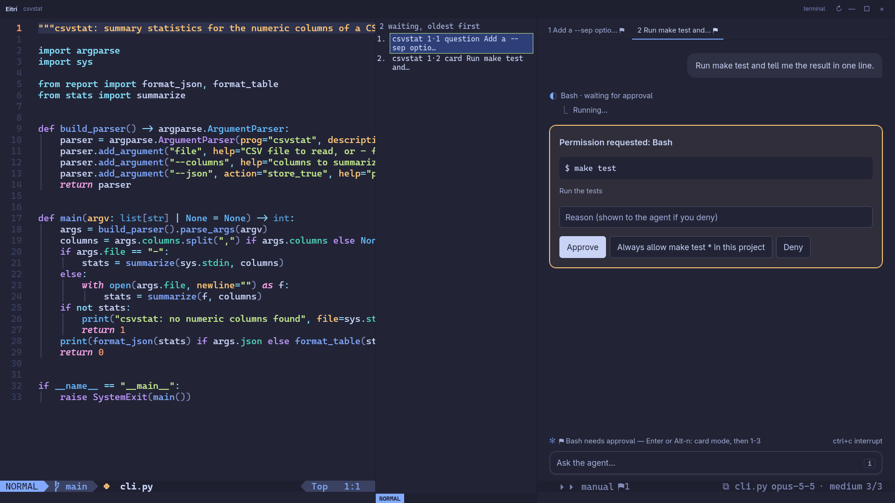

[English](write-a-plugin.md) | 简体中文
<!-- translated-from: write-a-plugin.md sha256=19c9cfd77c63e1cee939bb4c1db2af3b9daa4adce2737cc2b072132817a52f06 -->

# 写一个插件

插件就是把你自己的工具放到编辑器旁边的办法：比如一块按你自己的思路排布你的 agent 的看板，或者一个运行你项目自己的脚本、显示它们打印内容的页面。Eitri 自带的三个 agent 页面（[同时用很多 agent](many-agents.zh-CN.md)）就是普通的插件。它们用的是下面讲的同一个 `agents` 能力，没有任何你的插件用不到的东西。

[你自己做的页面](pages.zh-CN.md)是简短的介绍，里面有一个可以照抄的第一个插件。这一页是参考：插件可以声明什么、它的页面怎样和 Eitri 通信、`agents` 能力的每个调用和事件，以及发布之间什么保持稳定。它最后是一个完整的页面，列出在等你的 agent。

**插件是实验性的。** 任何人都可以写和分享，格式也对此开放，但它是 0.x：在它上面做东西之前，先读[什么保持稳定](#what-stays-stable)。

<a id="what-a-plugin-is"></a>
## 插件是什么

- **一个目录**，里面有一个 `eitri-plugin.toml`（清单）和一个小小的静态网站。Eitri 把这个网站的入口页作为窗口的一个模块 `lua:<id>` 显示出来，和编辑器、聊天、终端放在一起。
- **网页视图里的一个页面。** 页面运行在 WebKitGTK 里，地址是 `eitri-plugin://<id>/`，受严格的内容安全策略约束：脚本和样式表只能来自这个网站，没有内联脚本，没有 `eval`，网络请求只能发往它的清单列出的来源（细节见[页面运行在什么里面](pages.zh-CN.md#what-the-page-runs-in)）。
- **一份封闭的能力清单。** 页面只能通过 `window.eitriPlugin` 到达 Eitri，并且只能用它的清单声明过的能力。需要清单里没有列出的能力的调用，会以 `not_declared` 被拒绝。
- **Eitri 里没有原生代码。** 需要程序的插件把它声明为一个任务。Eitri 不经过 shell，把它作为一个单独的进程启动：程序必须是插件目录里的一个文件，运行在任务的 `cwd` 里，而 `cwd` 在插件的某个 root 里。它的输出一行一行发给页面。插件带来的任何东西都不会被加载进 Eitri 自己的进程。
- **由 `init.lua` 加载。** `eitri.plugin.load("<id>")` 按名字从 `~/.local/share/eitri/plugins/<id>/`（或者[插件](configuration.zh-CN.md#plugins)列出的其他地方）加载，`eitri.plugin.load("/path/to/dir")` 可以从任何地方加载。`:Eitri plugin load <id>` 把一个插件加载进正在运行的窗口，只对这一次运行有效。

<a id="trust-today"></a>
## 信任，目前

目前还没有同意界面。**加载插件就是授权：**你自己的 `init.lua` 里的 `eitri.plugin.load` 这一行，会把清单里列出的每一项能力都交给这个插件，带任务的插件会以你的身份、用你的文件和你的网络运行它的程序。所以眼下的规矩是：加载之前先读代码，就像运行别人发给你的脚本之前那样。Eitri 会把每个插件的能力清单记在 `~/.local/state/eitri/plugins/<id>/` 下，清单变了就在下次启动时说一声；它什么也不问。

你自己数据目录里的副本排在 Eitri 随附的副本前面，这就是你修改或替换一个随附插件的办法：把 `/usr/share/eitri/plugins/agents-top/` 复制到 `~/.local/share/eitri/plugins/agents-top/`，改它，下一个窗口加载的就是你的。随附的副本没有任何特殊地位，也没有任何东西会拿插件的文件去核对什么。每次加载都会在你启动 Eitri 的那个终端里打印它用的是哪个目录：

```text
[plugin agents-top] loaded /home/you/.local/share/eitri/plugins/agents-top (user data directory)
```

<a id="the-manifest"></a>
## 清单

```toml
id = "waiting-list"          # the name you load it by
title = "Who waits"          # the module's chip and the tray
protocol = 1
site = "site"                # the directory of the page's files, relative to the plugin
entry = "index.html"         # the page inside it
capabilities = ["agents", "layout.focus"]
```

表不认识的键、或者它不接受的值，会让加载停下；Eitri 启动时会把它列出来，点出那个键。

| 键 | 它放什么 |
|---|---|
| `id` | 小写字母、数字和 `-`，最多 40 个字符，两端都不能是 `-`。按名字加载时，它必须等于目录的名字 |
| `title` | 模块标签上的名字 |
| `summary` | 可选：一行文字，最多 80 个字符，显示在 Eitri 提供加载这个插件的地方（空标签页的 Pages 列表）里的标题旁边 |
| `protocol` | `1`，目前只有这一个版本 |
| `site`、`entry` | 相对路径，不能含 `..` |
| `capabilities` | 页面可以用的能力，来自下面的表 |
| `[settings.<name>]` | `eitri.plugin.load` 的一个选项，带一个 `kind`：`bool`（`default` 是 `true` 或 `false`）、`choice`（`values`，一到八个词，和其中一个作为 `default`）、`int`（`min`、`max` 和一个可选的 `default`；没有的话，这个设置在 `init.lua` 给它值之前是未设置的）或 `dir`（一个路径，不存在就创建）。名字是小写的，最多 32 个字符，不能是 `plugin`、`key` 或 `position` |
| `[module]` | `start`（第一次启动时 `"shown"` 或 `"hidden"`）、`at`（一个[打开规则](configuration.zh-CN.md#where-a-new-module-opens)的位置）、`size`（一个份额，或 `"<n>px"`）、`focus`（打开时是否拿走按键）、`key`（模块自己的键，遇到你或你的 tmux 配置已经在用的键就让路）和 `shown_while = "agents-wait"`（见下） |
| `[roots]` | `editor.open`、`editor.assist` 和任务可以碰的目录，用 `${plugin}` 或一个 `dir` 设置来写 |
| `[tasks.<name>]` | `argv`（它的第一个词是 `${plugin}/<path>`，插件里面的一个程序）、`cwd`（在一个 root 里面）和 `timeout_secs`（`0` 表示没有，最多一天） |
| `[vars.<name>]` | 页面传给任务的一个值：`chars`（`"lower-digit-dash"`、`"lower-digit"` 或 `"digit"`）和 `max_len`（1 到 256）；值不能以 `-` 开头或结尾 |
| `[net]` | `origins`（页面可以从中获取内容的 `https://host[:port]`）和 `images`（`"https"`、`"off"`，或取这两个值的一个 choice 设置） |
| `[follow]` | 页面在编辑器里跟随的 `filetypes`（一到十六个），以及 `auto_show`（一个 bool 设置） |
| `[commands.<Name>]` | 最多八个显示、切换或隐藏这个页面的 Neovim 命令（`does = "show"`、`"toggle"` 或 `"hide"`） |
| `[page]` | 页面要把它的状态交给另一个窗口里取代它的页面时，`handoff = true` |
| `[window]` | `root`、`title`、`focus` 和 `layout`：在那个目录里启动 Eitri 时打开的窗口是插件自己的 |

`[module] shown_while = "agents-wait"` 需要 `agents` 能力和 `start = "hidden"`。这样每当有 agent 在等你（或者一轮在进行）时，Eitri 就显示这个模块，没有时再把它隐藏，不移动按键。The pass 用的就是它。

<a id="capabilities"></a>
## 能力

每项能力允许一组固定的调用和事件。`host.hello` 和 `keys.declare` 不需要任何能力，`focus`、`keys_config` 和 `theme` 这几个事件也不需要。`page.saved`、`page.ready` 和 `host.save` 事件同样不需要能力：`[page] handoff = true` 允许它们，给那种把自己的状态交给另一个窗口里替换它的页面的页面用。

| 能力 | 调用 | 事件 | 页面因此可以做什么 |
|---|---|---|---|
| `state` | `state.read`、`state.write`、`log.append`、`log.read` | | 按键保存 JSON 值（最多 64 个键，每个值最多 192 KiB），并追加日志，都在 `~/.local/state/eitri/plugins/<id>/` 下 |
| `layout.focus` | `layout.focus` | | 把按键交给编辑器，或拿回来（`target` 是 `"editor"` 或 `"self"`） |
| `editor.open` | `editor.open` | | 在编辑器里打开一个 root 里的文件，到某一行某一列 |
| `editor.assist` | `editor.assist`、`editor.assist_clear` | | 为 root 下的文件打开或关闭诊断和内嵌提示 |
| `tasks` | `task.start`、`task.cancel` | `task.output`、`task.exit` | 运行插件自己的 `[tasks]` 并读它们的输出 |
| `net` | | | 从 `[net]` 的来源获取内容，`[net] images = "https"` 时还能从任何主机加载 `https` 图片；页面里没有别的东西能出去 |
| `editor.follow` | `editor.follow`、`editor.reveal`、`editor.jump`、`editor.open_link` | `editor.view`、`editor.text`、`editor.closed` | 跟随你正在编辑的缓冲区，滚动它，移动它的光标 |
| `editor.commands` | | | 在 Neovim 里定义 `[commands]` |
| `editor.cwd` | `editor.cd` | | 改变编辑器的目录，只在插件自己的窗口里 |
| `editor.buffers` | `editor.preload`、`editor.modified`、`editor.reload`、`editor.diff` | | 加载、列出、重新加载一个 root 下的缓冲区，并对它们做 diff |
| `terminal.cwd` | `terminal.at` | | 在一个 root 下的目录里启动终端，只在插件自己的窗口里 |
| `agents` | `agents.watch`、`agents.focus`、`agents.new`、`agents.select`、`agents.round`、`agents.stop` | `agents.row`、`agents.gone`、`agents.reset`、`agents.selection`、`agents.round` | 看到每个 Eitri 窗口的每个 agent 标签页并对它们操作（见下） |

`agents` 和 `net` 不能同时声明。能读到你的 agent 的页面不能同时访问网络，这样它了解到的关于它们的任何事都不可能通过它离开这台机器；加载会以 `agents and net cannot be declared together` 被拒绝。

开在你自己的 Neovim 旁边的页面窗口（`eitri page <id>`）只认 `editor.follow`、`editor.commands`、`editor.open`、`state` 和 `net`，声明了别的任何能力、或者带有 `[window]` 表的插件都会被它拒绝。

<a id="the-bridge"></a>
## 桥

`window.eitriPlugin` 是页面通往 Eitri 的唯一连接：

- `call(verb, args)` 返回这次调用结果的 promise。它被拒绝时给出一个 `Error`，它的 `code` 说明原因，`message` 用文字说出来。
- `on(event, fn)` 在事件每次到达时，用事件的数据调用 `fn`。

先调用 `host.hello`。它的结果包含页面的 `settings`、清单声明的 `capabilities`、`theme`、窗口的 `prefix` 和 `timeoutlen`、给按键工具包用的 `keys_settings`、`module_key`、`own_window`，以及它的任务里仍在运行的那些运行。除 `theme` 之外的每个事件都要等它，`keys.declare` 也一样。重新加载的页面是一份新的文档，要重新问候一次。

一条消息最多 256 KiB（`page.saved` 消息多 1 KiB，用来包住它的状态）。错误码有 `bad_request`（未知的动词、未知或缺少的参数、超出范围的值）、`not_declared`、`not_own_window`、`outside_roots`、`no_such_task`、`bad_var`、`busy`、`editor_unavailable`、`editor_timeout`、`too_large`、`io`，对 `agents` 还有 `disabled`、`gone`、`no_window`、`no_gesture` 和 `refused`。每个调用都在它的期限内得到回答（编辑器和 agent 是五秒），所以页面不需要自己的计时器。

颜色和字体以 `--nv-*` CSS 变量的形式到达，位于 `/.eitri/keys.js` 的按键工具包给页面所有插件页面共用的那些键；[你自己做的页面](pages.zh-CN.md#what-the-page-runs-in)对两者都有说明。

<a id="the-agents-capability"></a>
## `agents` 能力

你机器上的每个 Eitri 窗口，为每个 agent 标签页发布一行：它是谁、处于什么状态、从什么时候起、是否在等你。带有 `agents` 的页面可以读到所有这些，来自每个窗口、每个项目，并且可以把你带到其中一个那里。这足以让你用自己的顺序、分组和按键，做出你自己的 agent 视图。

它做不到的事：

- **没有任何东西替你回答。** 没有任何调用、行或事件会回答权限卡片、提问或信任问题。移到一张卡片永远不会在里面按任何键；你在聊天里用聊天的键来回答。
- **没有对话文字。** 行里没有提示词、回复、工具输入、路径或失败原因。标签（label）是唯一来自提示词的内容（聊天给标签页起的标题，截到 40 个字符）。
- **除 `agents.watch` 之外的每个调用都需要你的手势。** 页面的模块必须拿着按键，并且在调用之前不到一秒内，必须有一次按键、一次按钮点击或一次触摸到达过页面。页面自己的脚本造不出这样的事件，所以页面不能自己把你挪来挪去。`agents.new` 在上一次之后的一秒内也会被拒绝。
- **`agents` 和 `net` 互相排斥**，如上所述。

<a id="the-calls"></a>
### 调用

| 调用 | 参数 | 结果 | 被拒绝时给出 |
|---|---|---|---|
| `agents.watch` | `{}` | 完整的视图（见下） | `disabled`（这个窗口里 agent 是关着的）、`busy`（5 秒内没有视图）、`io`（读取失败） |
| `agents.focus` | `{id, card_first?}` | `{}` | `gone`（那一行已经离开）、`no_gesture`、`refused`、`busy`、`disabled` |
| `agents.new` | `{project}`，视图 `projects` 里的一个项目键 | `{}` | `no_window`（那个项目没有窗口在运行）、`refused`（在上一次之后的一秒内，或窗口拒绝了）、`no_gesture`、`busy`、`disabled` |
| `agents.select` | `{key}` | `{}` | `gone`（没有哪一行是这个键）、`refused`（共用的选中项写不进去）、`no_gesture`、`busy`、`disabled` |
| `agents.round` | `{op, key?}`，`op` 是 `"start"`、`"next"` 或 `"leave"` | `{}` | `refused`（页面的 `agents.watch` 还没得到回答、在一行没有在等时 `start`、没有谁在等、或者这一轮写不进去）、`gone`（那个键的行走了）、`no_gesture`、`busy`、`disabled` |
| `agents.stop` | `{id}` | `{}` | `gone`、`refused`（那里没有东西在运行）、`no_gesture`、`busy`、`disabled` |

每个调用对它不认识的参数还会回答 `bad_request`，没有这项能力时回答 `not_declared`。

- **`agents.watch`** 回答现在的视图；再问一次，就再回答一次。Eitri 在这个页面的任何 `agents.*` 事件之前先发出这个回答，所以随后的事件都比这个视图新，中间也不会丢掉任何一个。
- **`agents.focus`** 把那一行的聊天带到前面，不管它在哪个窗口；`card_first` 为 `true`（默认 `false`）时，把它的卡片摆在最前。在 GNOME 上，窗口能来到前面，是因为你的按键请求了它。
- **`agents.new`** 在那个项目正在运行的一个窗口里新开一个 agent 标签页。
- **`agents.select`** 移动每个 agent 页面共用的选中项，在每个窗口里都一样。
- **`agents.round`** 从最早开始，依次走过在等的 agent，和 `<prefix> u` 一样。`start` 从 `key`（或最早在等的那个）开始，或者把正在进行的一轮移到那里，并把那个聊天带到前面，卡片摆在最前；`next` 去下一个（没有正在进行的一轮时就开始一轮；没有剩下的站点时，这一轮停在原处结束，调用照样成功）；`leave` 结束这一轮，回到出发的地方。
- **`agents.stop`** 把那一行的聊天带到前面，并在那里问 `Stop this turn? (y/n)`。在聊天里回答 `y` 之前，什么都不会停。

<a id="the-events"></a>
### 事件

事件只在页面的 `host.hello` 和 `agents.watch` 都得到回答之后、并且只在它的模块在屏幕上时才会到达页面。听不到某些变化的页面（它不在屏幕上，或者正在加载），会在其他一切之前收到一次带完整视图的 `agents.reset`。

| 事件 | 数据 |
|---|---|
| `agents.row` | 新的或变了的一行（就是行本身：`data.id`，不是 `data.row.id`） |
| `agents.gone` | 离开的一行的 `{id, key, why}` |
| `agents.reset` | 完整的视图，用来替换页面持有的一切 |
| `agents.selection` | 共用的选中项，或 `null` |
| `agents.round` | 这一轮，或 `null` |

行有 `key` 时，就按 `key` 来保存行：移到另一个窗口的标签页会以新的 `id`、相同的 `key` 回来，而旧 `id` 的 `agents.gone` 可能在新行之后才到达。只有当你为那个 `key` 持有的 `id` 就是离开的那个时，才在 `agents.gone` 上移除这一行。

声明了 `agents` 的页面，在它自己的脚本运行之前，还会得到 `window.eitriAgents`：一个按这种方式应用这些事件的行仓库、每个状态一个图标和一个词，以及[共用操作](many-agents.zh-CN.md#the-shared-grammar)的各个键（`j`、`k`、`Enter`、`c`、`x`、`/`、`Esc`），所以你的页面用几行就能和自带的三个表现一致。最后的例子改为直接使用桥，这样你可以看到每个调用。

<a id="the-rows"></a>
### 行

完整的视图和 `eitri agents --watch` 的每一行带有 `"v": 1`；单独的一行没有（下面的例子里没有 `v`），页面事件的内容也没有，只有 `agents.reset` 的内容例外，因为它就是完整的视图。读取方必须忽略它不认识的字段，并把不认识的状态按它的 `class` 来处理。一行如下：

```json
{
  "id": "a3f09c1d2e4b5f60.7",
  "key": "k-5c1e0b9a7d3f2e18",
  "agent": "claude",
  "project": { "key": "9b2c4e7a10f3d856", "name": "eitri" },
  "window": { "instance": "a3f09c1d2e4b5f60", "name": "1", "focused": true },
  "number": 3,
  "label": "close question",
  "label_from": "title",
  "shown": false,
  "state": "card",
  "class": "needs",
  "since": 1793865600123,
  "needs": { "cards": 1, "questions": 0, "trust": false },
  "waiting_since": 1793865600123,
  "unread": false,
  "tool": "Bash",
  "background": { "calls": 0, "shells": 0, "monitors": 0, "agents": 0, "other": 0 },
  "queued": 0,
  "mode": "manual",
  "ended_how": null,
  "moving": false
}
```

| 字段 | 含义 |
|---|---|
| `id` | `<instance>.<tab>`；这一行存在期间有效；是 `focus` 和 `stop` 的参数 |
| `key` | `k-` 加 16 位十六进制数，标签页自己的，标签页移到另一个窗口或被恢复时保持不变 |
| `agent` | `claude`、`codex` 或 `acp:<name>` |
| `project` | `key`（16 位十六进制，不含路径）和 `name`（文件夹名，截到 40 个字符） |
| `window` | `instance`（每次进程启动随机生成）、`name`（`1`、`2`，未配对的窗口是 `u`，合成器聊天窗口是 `c1`..`c9`，还有 `companion`）、`focused` |
| `number` | 那个窗口标签栏上的编号（不是全局的） |
| `label`、`label_from` | 最多 40 个字符；来自 `rename`、`title`、`session` 或 `new` |
| `shown` | 这个标签页是屏幕上某个聊天的当前标签页 |
| `state`、`class` | 见下 |
| `since` | 这一行进入当前状态的时间，毫秒，自 epoch 起，用写入进程的时钟 |
| `waiting_since` | 最早的卡片、提问或信任问题第一次被看到的时间，或 `null`；这一轮按它排序 |
| `needs` | 卡片数和提问数，以及有没有信任问题在等（一个标签页可以同时有卡片和提问） |
| `unread` | 一个回合在聊天不在屏幕上时结束了 |
| `tool` | 打开着的工具调用的名字（或最早那张卡片的），绝不含它的输入 |
| `background` | `calls` 是总数；按种类分的四个计数，在 `calls` 不为 0 时也可能全是 0 |
| `queued` | 打好了、等回合结束再发送的消息数 |
| `mode` | `manual`、`auto` 或 `bypass` |
| `ended_how` | `closed`、`stopped`、`unavailable`、`start_failed` 或 `tripped`；绝不含原因文字 |
| `moving` | 这个标签页正在移到另一个窗口的途中 |

状态，按决定一行是哪个状态的顺序排列（第一个成立的生效）：

| 状态 | 类别 | 图标 | 什么时候 |
|---|---|---|---|
| `card` | needs | `⚑` | 有权限卡片或工具卡片在等 |
| `question` | needs | `?` | 有一组提问在等 |
| `trust` | needs | `?` | 一次启动在等信任问题的回答 |
| `failed` | ended | `✕` | 标签页没能启动，或者它的会话未经要求就死了 |
| `ended` | ended | `✕` | 会话已关闭或被你停掉，而标签页仍然开着 |
| `running` | working | `●` | 一个回合在运行 |
| `background` | working | `◌` | 没有回合在运行，但有后台任务 |
| `starting` | working | `…` | 会话正在打开 |
| `done` | quiet | `•` | 空闲，并且有一个回合在聊天不在屏幕上时结束了 |
| `idle` | quiet | `·` | 一个活着的会话，没有东西在运行，也没有未读 |
| `new` | quiet | （空白） | 还没有会话的标签页 |

完整的视图，也就是 `eitri agents --json` 打印的、`agents.watch` 回答的：

```json
{ "v": 1, "at": 1793865600200, "enabled": true, "projects": [ ... ], "rows": [ ... ],
  "selection": { "key": "k-…", "by": "a3f09c1d2e4b5f60", "at": 1793865600100 } | null,
  "round": { "from": { "instance": "a3f09c1d2e4b5f60", "module": "…", "tab": null }, "current": "k-…",
             "visited": [ ... ], "started_at": 1793865500000, "at": 1793865600100 } | null }
```

`projects` 列出每个有窗口在运行的项目，`{key, name}`，包括窗口里没有任何标签页的项目，这样页面可以在那里提供 `new`。行按项目名和键、窗口名和实例、编号排序。`--watch` 的第一行是完整的视图，和 `--json` 打印的一样（没有 `type`）；之后的每一行把一个变化包在一个带 `v` 和 `type` 的外壳里：

```json
{ "v": 1, "type": "row",  "row": { ... } }
{ "v": 1, "type": "gone", "id": "a3f09c1d2e4b5f60.7", "key": "k-5c1e0b9a7d3f2e18", "why": "closed" }
{ "v": 1, "type": "reset", "view": { ... } }
{ "v": 1, "type": "selection", "selection": { ... } | null }
{ "v": 1, "type": "round", "round": { ... } | null }
```

页面收不到这些外壳，它的回调只拿到里面的内容：`agents.row` 就是那一行本身（用 `event.id`，不是 `event.row.id`），`agents.gone` 是 `{id, key, why}`，`agents.reset` 是完整的视图（只有这个带 `v`），`agents.selection` 是选中项或 `null`，`agents.round` 是这一轮或 `null`。

`why` 是 `closed`（标签页关了）、`moved` 或 `window`（它的进程结束了，或者关掉了这一层）。一个进程最多发布 64 行、64 KiB：超过 64 行时，按标签页编号发布前 64 行；超过 64 KiB 时，从标签页编号最大的行开始去掉，直到文件放得下。

<a id="the-keys-kit-windoweitrikeys"></a>
## 按键工具包：`window.eitriKeys`

每个插件页面都可以从 `/.eitri/keys.js` 加载按键工具包；声明了 `agents` 的页面，在它自己的脚本运行之前就已经有了它。它给页面提供所有插件页面共用的键，并运行页面自己的键。`host.hello` 由页面自己调用，再把工具包需要的东西从回复里交给它：

```js
const hello = await window.eitriPlugin.call("host.hello");
const remove = await window.eitriKeys.install({
  rows: [{ action: "list.open", keys: ["<CR>"], context: "my page", desc: "open the selected item" }],
  run(action, event) { if (action === "list.open") { openSelected(); return true; } return false; },
  initial: { timeoutlen: hello.timeoutlen, hasKeys: true, prefix: hello.prefix, settings: hello.keys_settings },
});
```

- **`install(options)`** 把这些行声明给 Eitri（`keys.declare`，所以 `?` 和 Eitri 的按键表会列出它们），返回一个 promise，兑现为一个移除这次安装的函数。再次安装会替换先前的安装。按下你的某个键时会调用 `run(action, event)`，它处理了就返回 `true`。一行是 `{action, keys, context, desc}`：`action` 由小写字母、数字和 `_.-` 组成，最多 40 个字符；一到十个键，用 Vim 的写法（`j`、`gg`、`<C-d>`、`<CR>`、`<Esc>`）；`context` 最多 40 个字符，`desc` 最多 80 个。Eitri 保留的键（前缀键、`Ctrl+h/j/k/l`、`Ctrl+=`、`Ctrl+-`、`Ctrl+0`、`F11`、任何 `Ctrl+Shift` 或 Super 组合）会被拒绝，你的两个动作共用一个键也会被拒绝。
- **共用的行在前面：** 滚动（`j`/`k`、`d`/`u`、`Ctrl+f`/`Ctrl+b`、`gg`/`G` 等）、历史（`H`/`L`）、`[[`/`]]`、查找（`/`、`n`、`N`）、提示（`f`）、按键表（`?`）、`Esc`，以及可视模式（`v`、`V`）。你的某一行和共用的行 `action` 相同，就替换那一行；你的行用到的键会从共用的行里拿走，所以你的 `j` 胜过滚动。
- **其他选项：** `targets()`（除了链接和控件之外，`f` 还要标注什么）、`labels`（`?` 表和状态行里的文字，给用别的语言的页面）、`find`（`{root, exclude}`：`/` 查找的范围）、`bottom()`（`G` 去哪里）、`onJump(when)`（在工具包自己的跳转之前和之后告诉页面，给记录历史的页面用），以及 `visual`（`{start, follow, keys}`：`v` 和 `V` 从哪里开始、页面如何跟随选区、选区存在时页面自己的键）。
- **`window.eitriKeys` 的其余部分：** `version`、`setCurrent(element)`（给页面当作当前的元素加上类名 `eitri-keys-current`）、`message(text)` 和 `status(text)`（工具包在页面底部的那一行）、`keys(action)`（一个动作现在的键，已算上 `init.lua` 的修改）、`findRefresh()` 和 `findSeed(query)`（告诉 `/` 页面改了文字，或设定 `n` 和 `N` 要找的内容）、`scrollTo(top)`、`destination()` 和 `settle()`（工具包自己的平滑滚动），以及 `endVisual()` 和 `visualMode()`。
- **用户自己的键优先。** `init.lua` 里的 `eitri.keymap.set("plugin:<id>", "<key>", "<action>")` 可以改你页面的某个键；工具包会应用它，`keys(action)` 也会报出它。

工具包的 `version` 是 5。到目前为止它只靠增加来扩展（4 加了 `scrollTo`、`destination`、`settle`、`bottom` 和 `onJump`；5 加了可视模式），所以用到这些的页面要先检查 `window.eitriKeys.version`。

<a id="colours-and-fonts-the---nv--tokens"></a>
## 颜色和字体：`--nv-*` 变量

Eitri 在 `host.hello` 时、以及每次配色方案变化时，把这些 CSS 变量设在页面的根元素上，所以用了它们的页面会跟着 Eitri 的外观走，浅色深色都一样。它们由你的 Neovim 配色方案算出来。根元素上 `--nv-` 开头的名字归 Eitri 所有：页面自己在这些名字下设的值会被覆盖。

| 变量 | 是什么 | 用来做什么 |
|---|---|---|
| `--nv-bg`、`--nv-fg`、`--nv-muted` | 编辑器的背景、文字和次要文字 | 页面的底色和文字 |
| `--nv-surface`、`--nv-surface-fg`、`--nv-surface-muted` | 一层浮起的表面（Neovim 的浮动窗口）和在它上面可读的文字 | 面板、输入框、卡片 |
| `--nv-chrome`、`--nv-chrome-fg`、`--nv-chrome-muted` | 状态栏的填充色和在它上面可读的文字 | 应该看起来像 Eitri 栏条的标题行或底栏 |
| `--nv-chrome-accent` | 状态栏的强调色 | 边框、分隔线、填充或图标，永远不用于文字 |
| `--nv-border`、`--nv-cursorline`、`--nv-search` | 分隔线、编辑器当前行的色带、搜索匹配 | 各部分之间的线、选中的行、高亮的匹配 |
| `--nv-focus-ring`、`--nv-focus-ring-inactive` | 有焦点的控件的轮廓，以及它为没有焦点的控件调淡的版本 | 轮廓和边框，永远不用于文字 |
| `--nv-hint-bg`、`--nv-hint-fg` | `f` 的标签 | 你自己的标签 |
| `--nv-warn`、`--nv-error`、`--nv-ok` | 信号色 | 只用于边框、圆点和图标：不保证作为文字可读 |
| `--nv-tint`、`--nv-warn-tint`、`--nv-error-tint`，各自带 `-fg` 和 `-muted` | 三种离背景只差一小步的填充色（你的、警告、错误），各自配有在上面可读的文字 | 属于你的一行、等用户处理的一行、失败的一行 |
| `--nv-link` | 编辑器给 Markdown 链接用的颜色，和编辑器画的一样（没有做对比度保护） | 链接文字 |
| `--nv-syn-comment`、`-constant`、`-function`、`-keyword`、`-number`、`-operator`、`-property`、`-punctuation`、`-string`、`-tag`、`-type`、`-variable` | 配色方案的语法颜色 | 代码，像编辑器那样画 |
| `--nv-mode-browse`、`--nv-mode-input`、`--nv-status-{normal,insert,visual}-{bg,fg}`、`--nv-cursor-band`、`--nv-cursor-band-inactive` | 聊天面板的模式颜色、状态栏的模式块（按你的状态栏插件画的样子），以及聊天的光标色带 | 要和它们一致的边框和填充；模式颜色和模式块的文字没有做对比度保护 |
| `--nv-font-mono`、`--nv-font-prose` | 编辑器的字体列表（来自 `guifont`）和一个正文字体列表 | `font-family` |
| `--nv-text-size` | 编辑器的文字大小，换算成页面的像素（`18.67px`）；在你自己的 Neovim 旁边的窗口里不发送 | `font-size: var(--nv-text-size, 14px)` |
| `--nv-color-scheme` | `light` 或 `dark` | 选择浅色或深色的样式；`prefers-color-scheme` 也跟着它 |

文字颜色（`fg`、`muted`，以及每一对 `-fg`/`-muted`）选来在与它配对的填充色上可读；信号色、强调色和焦点色只按标记来保护，语法色、链接色和模式色是编辑器自己的颜色，完全没有保护。

<a id="the-agents-kit-windoweitriagents"></a>
## agents 工具包：`window.eitriAgents`

声明了 `agents` 的页面，在它自己的脚本运行之前会得到 `window.eitriAgents`。它替你做[事件](#the-events)里说的那些记账，并给页面提供自带的 agent 页面共用的键。

```js
const agents = window.eitriAgents;
await agents.start();                       // host.hello, then agents.watch, events applied in order
agents.store.on(() => draw(agents.store.rows()));
const unbind = await agents.bindKeys({ order: () => shownKeys(), onFilter: (query) => filter(query) });
```

- **`start()`** 先调用 `host.hello`，再调用 `agents.watch`；在发出请求之前就开始监听五个事件，期间到达的事件在视图之后应用。再次调用会返回同一个 promise；被拒绝的启动（比如 `disabled`）可以再试。
- **`store`**：`rows()`（行的副本，按视图的顺序：项目、窗口、标签页编号）、`byKey(key)`（那一行，或 `undefined`）、`selection()`（共用选中项的键，或 `null`）、`round()`（这一轮，或 `null`）和 `on(fn)`（每次变化之后调用；返回一个停止它的函数）。仓库按键存放行，`agents.gone` 只作用于它手里那个 `id`，和[事件](#the-events)里说的一样。
- **`glyph(row)` 和 `word(row)`**：上面状态表里的图标和它的词；这个工具包不认识的状态按它的类别回退。
- **`bindKeys({order, onFilter?})`** 需要时先开始监视，再通过 `window.eitriKeys` 安装共用的键：`j`/`k` 按 `order()` 返回的顺序（你的页面显示的那些行的键）移动共用的选中项；`Enter` 在选中的、在等的行上开始一轮，否则去到它的聊天；`c` 在它的项目里新开一个 agent；`x` 请它停下；`/` 打开一个筛选行并调用 `onFilter(query)`；页面声明了 `layout.focus` 时，`Esc` 把按键交给编辑器。拒绝会显示在按键工具包的消息行里。它返回一个 promise，兑现为一个移除这些键和筛选行的函数。
- **`version`** 是 1。

`bindKeys` 通过按键工具包安装，而一次安装会替换前一次。所以想在共用的键旁边加上自己的键的页面，要在 `bindKeys` 运行期间包一层 `window.eitriKeys`，自带的页面就是这样做的：

```js
const keys = window.eitriKeys;
const MARK = { action: "mine.mark", keys: ["m"], context: "Agents", desc: "mark the selected agent" };
window.eitriKeys = {
  ...keys,
  install: (options) => keys.install({
    ...options,
    rows: [...options.rows, MARK],
    run: (action, event) => (action === MARK.action ? (markSelected(), true) : options.run(action, event)),
  }),
};
try {
  await window.eitriAgents.bindKeys({ order: () => shownKeys() });
} finally {
  window.eitriKeys = keys;
}
```

这是现在的做法，不是设计好的接口；以后的发布可能会让 `bindKeys` 有办法加行。

<a id="what-stays-stable"></a>
## 什么保持稳定

插件格式是 `protocol = 1`，只要它还是 1，改变就只通过增加：一个发布可以增加调用、事件、可选参数、结果或事件或行的字段、能力、清单键和 agent 状态，不会拿走其中任何一个，也不会改变任何一个的含义。为某个发布写的页面，只要遵守四条规则，在下一个发布里就还能用：

- **忽略你不认识的。** 页面不认识的字段、事件或行状态，比页面更新。跳过这个字段和这个事件；不认识的状态按它的 `class`（`needs`、`working`、`quiet`、`ended`）来读，这个 `class` 永远不变。
- **不要发送旧一点的 Eitri 不认识的东西。** Eitri 会用 `bad_request` 拒绝它不认识的参数，所以使用了后来的发布才加上的可选参数（比如 `editor.jump` 的 `select`）的页面，要准备好在更旧的 Eitri 上遇到这个拒绝。
- **在给出版本的地方检查版本。** 视图和 `eitri agents --json` 与 `--watch` 的每一行都带有 `"v": 1`；`eitri agents --schema 1` 宁可拒绝运行，也不打印更新的版本。两个工具包在 `window.eitriKeys.version` 和 `window.eitriAgents.version` 里说出各自的版本；对后来的版本加的东西做功能检测（工具包本身的状态见下文）。
- **读发布说明。** 0.x 期间这个格式是实验性的。如果某个发布必须以不是增加的方式改变它，它的发布说明会写出来。

<!-- The paragraph below is the maintainer's to word; change it here and in the English page together. -->
**这两个工具包和这些变量还不在这条承诺之内。** `window.eitriKeys`、`window.eitriAgents` 和 `--nv-*` 变量这一套，在 0.x 里是实验性的，和协议分开：某个发布可能以不是增加的方式改变它们，发布说明会写出来。目前成立的是：每个工具包都有一个 `version`，接口扩展时它会升高（按键工具包是 5，agents 工具包是 1），而且按键工具包到目前为止只靠增加来扩展；Eitri 在页面看到每个变量之前，会检查它的名字和值的格式。用到什么就对什么做功能检测，并给每个 `var(--nv-...)` 一个后备值。

要求 `protocol = 2` 的清单，或者要求这个 Eitri 不认识的能力的清单，在加载时会被拒绝，并给出点名它的信息，所以更旧的 Eitri 永远不会只加载一半更新的插件。

<a id="a-complete-example-who-waits"></a>
## 一个完整的例子：谁在等

一个列出在等你的 agent 的模块，来自每个窗口，最早的在前：`j` 和 `k` 在列表里移动，`Enter`（或一次点击）去到那个 agent 的聊天，卡片摆在最前，`q` 把按键还给编辑器。同样的四个文件在 Eitri 源码树的 `examples/plugins/waiting-list/` 下，Eitri 的测试会从那里加载它们。

```text
~/.local/share/eitri/plugins/waiting-list/
├── eitri-plugin.toml
└── site/
    ├── index.html
    ├── page.js
    └── style.css
```

`eitri-plugin.toml`：

```toml
id = "waiting-list"
title = "Who waits"
protocol = 1
site = "site"
entry = "index.html"
capabilities = ["agents", "layout.focus"]

[module]
start = "hidden"
at = "right"
size = 0.3
```

`site/index.html`：

```html
<!doctype html>
<html lang="en">
<head>
<meta charset="utf-8">
<title>Who waits</title>
<link rel="stylesheet" href="style.css">
<script src="page.js" defer></script>
</head>
<body>
<p id="head">…</p>
<ol id="list"></ol>
</body>
</html>
```

`site/style.css`：

```css
body { margin: 0; padding: 8px; background: var(--nv-bg); color: var(--nv-fg); font-family: var(--nv-font-mono); }
#head { margin: 0 0 6px; color: var(--nv-muted); }
ol { margin: 0; padding-left: 2.5ch; }
li { padding: 2px 4px; }
li.picked { background: var(--nv-cursorline); outline: 1px solid var(--nv-focus-ring); }
```

`site/page.js`：

```js
const host = window.eitriPlugin;
const head = document.getElementById("head");
const list = document.getElementById("list");
const rows = new Map(); // by the tab's key, which stays when the tab moves to another window
let picked = 0;

const slot = (row) => row.key || row.id;
const waiting = () => [...rows.values()]
  .filter((row) => row.class === "needs")
  .sort((a, b) => (a.waiting_since ?? 0) - (b.waiting_since ?? 0));

function draw() {
  const shown = waiting();
  picked = Math.max(0, Math.min(picked, shown.length - 1));
  head.textContent = shown.length ? `${shown.length} waiting, oldest first` : "no agent waits for you";
  list.replaceChildren(...shown.map((row, at) => {
    const item = document.createElement("li");
    item.textContent = `${row.project.name} ${row.window.name}·${row.number}  ${row.state}  ${row.label}`;
    item.classList.toggle("picked", at === picked);
    item.addEventListener("click", () => { picked = at; goToPicked(); });
    return item;
  }));
}

function goToPicked() {
  const row = waiting()[picked];
  if (row) host.call("agents.focus", { id: row.id, card_first: true }).catch((e) => window.eitriKeys.message(e.message));
}

function load(view) {
  rows.clear();
  for (const row of view.rows) rows.set(slot(row), row);
  draw();
}

host.on("agents.row", (row) => { rows.set(slot(row), row); draw(); });
host.on("agents.gone", (gone) => { if (rows.get(gone.key || gone.id)?.id === gone.id) rows.delete(gone.key || gone.id); draw(); });
host.on("agents.reset", load);

async function start() {
  const hello = await host.call("host.hello");
  await window.eitriKeys.install({
    rows: [
      { action: "waiting.down", keys: ["j"], context: "Who waits", desc: "next agent" },
      { action: "waiting.up", keys: ["k"], context: "Who waits", desc: "previous agent" },
      { action: "waiting.open", keys: ["<CR>"], context: "Who waits", desc: "go to its chat, card first" },
      { action: "waiting.back", keys: ["q"], context: "Who waits", desc: "back to the editor" },
    ],
    run(action) {
      if (action === "waiting.down") { picked += 1; draw(); return true; }
      if (action === "waiting.up") { picked -= 1; draw(); return true; }
      if (action === "waiting.open") { goToPicked(); return true; }
      if (action === "waiting.back") { host.call("layout.focus", { target: "editor" }); return true; }
      return false;
    },
    initial: { timeoutlen: hello.timeoutlen, hasKeys: true, prefix: hello.prefix, settings: hello.keys_settings },
  });
  try {
    load(await host.call("agents.watch"));
  } catch (e) {
    head.textContent = e.code === "disabled" ? "agents are off in this window" : e.message;
  }
}

start();
```

然后，在 `init.lua` 里：

```lua
eitri.plugin.load("waiting-list", { key = "y" })
```

重启 Eitri，`<prefix> y` 就会显示带着按键的列表（清单让它一开始是隐藏的，放在拿着按键的模块的右边）。页面依赖的几件事：

- 它没有为按键工具包声明脚本标签：带有 `agents` 的页面，在它自己的脚本运行之前就拿到了 `window.eitriKeys` 和 `window.eitriAgents`。
- `Enter` 就是 `agents.focus` 需要的手势，而按键只有在页面拿着按键时才会到达页面，所以另一个条件也成立。点击只有在页面拿着按键时才算作手势。
- 它按 key 保存行，只有 `id` 匹配时才在 `agents.gone` 上移除一行，并从 `agents.reset` 重新开始，就像[事件](#the-events)所说的那样。
- 它从不声明 `net`，反正它也没法在 `agents` 旁边声明。



想让一个 agent 替你写这样的插件，把这一页和[你自己做的页面](pages.zh-CN.md)交给它，描述页面该做什么，并在加载之前读一读它写的东西。
