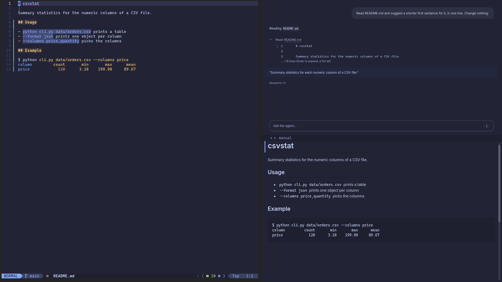

English | [简体中文](README.zh-CN.md)

# Beside a terminal Neovim

For you if you keep your Neovim in a terminal (in tmux or not) and want the agent panel and the Markdown preview as
windows beside it, without moving your editing into Eitri.

[`init.lua`](init.lua) loads the Markdown preview for the [page window beside your Neovim](../../../docs/guide/companion.md#pages-beside-your-nvim):
it follows each Markdown buffer you enter without coming forward, and `<prefix> b` in the panel opens it or brings it
forward. It also leaves `companion.wm` at `"auto"`, so `Ctrl+h/j/k/l` at the edge of Neovim's windows moves to the
panel's window and back.

Copy `init.lua` to `~/.config/eitri/init.lua`. Then add [eitri.nvim](../../../docs/guide/companion.md#the-eitrinvim-plugin)
to your Neovim; with lazy.nvim and a package install:

```lua
{
  dir = "/usr/share/eitri/nvim/eitri.nvim",
  lazy = false,
  config = function()
    require("eitri").setup({ mapping = "<leader>ep", page_mappings = { ["<leader>em"] = "markdown" } })
  end,
},
```

(the tarball installer puts it in `~/.local/share/eitri/eitri.nvim`). In Neovim, `<leader>ep` (or `:EitriPanel`) opens
the panel for the current directory and `<leader>em` (or `:EitriPage markdown`) the preview. From a shell,
`eitri panel` in Neovim's own terminal attaches to it too.


