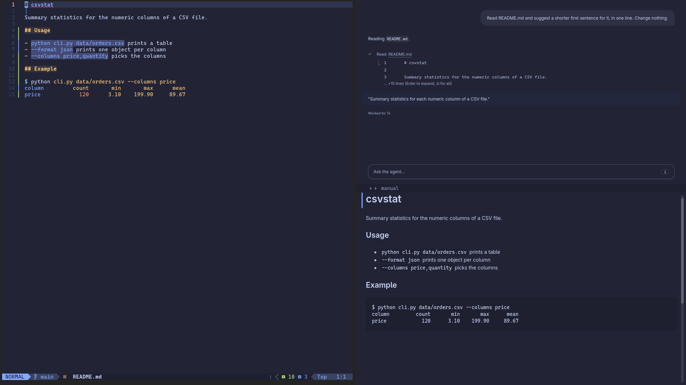

[English](README.md) | 简体中文
<!-- translated-from: README.md sha256=d678d3da7908c2bbc5c74d446e8c4bd9613f426603fa874544c28016c0c61891 -->

# 在终端 Neovim 旁边

适合你，如果你把 Neovim 放在终端里（在 tmux 里或不在），想让 agent 面板和 Markdown 预览作为窗口开在它旁边，而不把你的编辑搬进 Eitri。

[`init.lua`](init.lua) 为[开在你 Neovim 旁边的页面窗口](../../../docs/guide/companion.zh-CN.md#pages-beside-your-nvim)加载 Markdown 预览：它跟随你进入的每个 Markdown 缓冲区，但不会跳到前面来，面板里的 `<prefix> b` 打开它或把它带到前面。它还让 `companion.wm` 保持 `"auto"`，所以在 Neovim 窗口边缘按 `Ctrl+h/j/k/l` 会移到面板的窗口，再按回来。

把 `init.lua` 复制到 `~/.config/eitri/init.lua`。然后把 [eitri.nvim](../../../docs/guide/companion.zh-CN.md#the-eitrinvim-plugin) 加到你的 Neovim；用 lazy.nvim 和软件包安装的话：

```lua
{
  dir = "/usr/share/eitri/nvim/eitri.nvim",
  lazy = false,
  config = function()
    require("eitri").setup({ mapping = "<leader>ep", page_mappings = { ["<leader>em"] = "markdown" } })
  end,
},
```

（压缩包安装程序把它放在 `~/.local/share/eitri/eitri.nvim`。）在 Neovim 里，`<leader>ep`（或 `:EitriPanel`）为当前目录打开面板，`<leader>em`（或 `:EitriPage markdown`）打开预览。在 shell 里，Neovim 自己的终端里的 `eitri panel` 也会附着到它。


