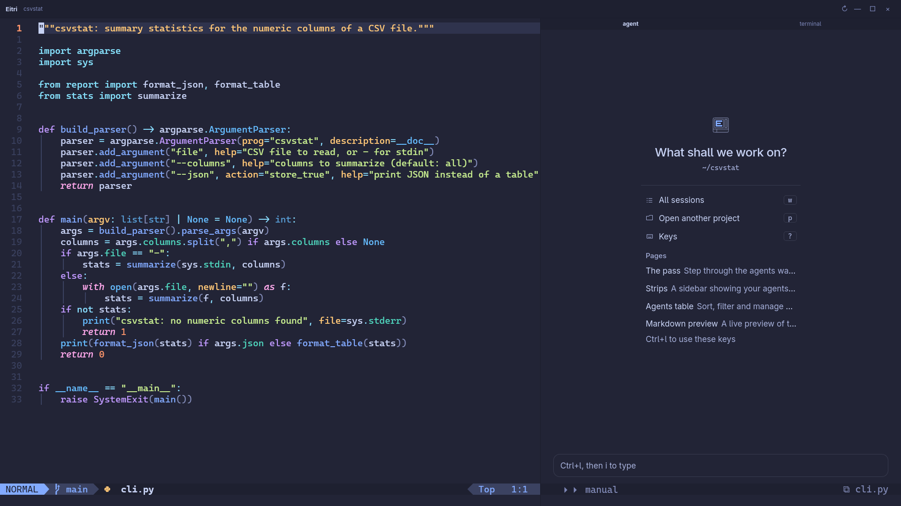
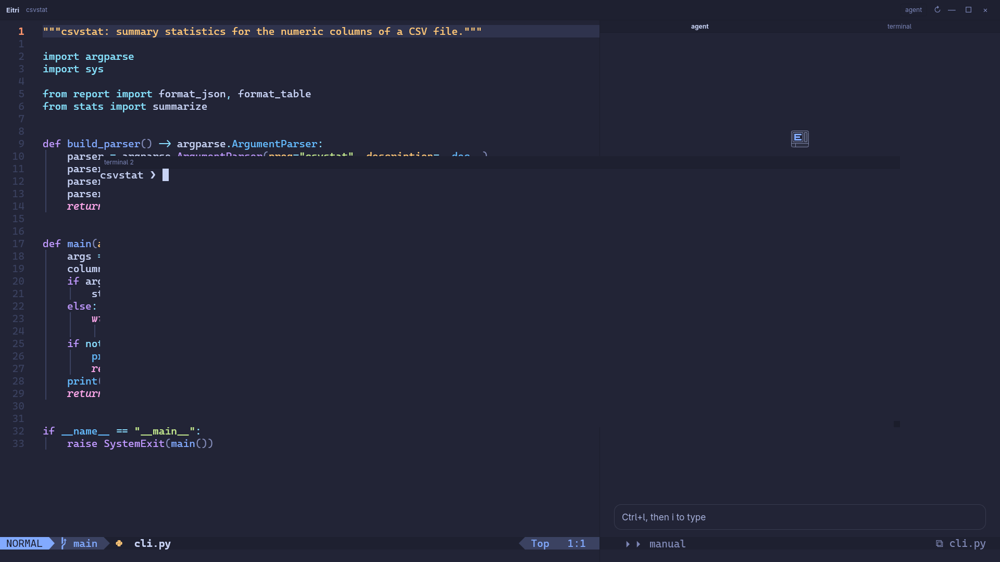

English | [简体中文](README.zh-CN.md)

# An i3 person

For you if you use i3 or sway with Alt as `$mod` and want Eitri's modules arranged like i3's containers, inside one
Eitri window.

Eitri's container keys are i3's `$mod` chords pressed after the prefix (`<prefix> Alt+w` makes a container tabbed).
With Alt as your window manager's `$mod`, the window manager takes those chords first. [`init.lua`](init.lua):

- moves them to `Ctrl+Alt` (`eitri.keymap.use("i3-alt")`): `<prefix> Ctrl+Alt+w` tabbed, `<prefix> Ctrl+Alt+s`
  stacked, `<prefix> Ctrl+Alt+Enter` a new terminal, `<prefix> Ctrl+Alt+h/j/k/l` move;
- keeps chats and pages inside Eitri's window (`window.tiling = "eitri"`). On sway, Hyprland and niri they would
  otherwise be windows of your window manager; remove that line if you want sway to tile them, and see
  [Compositor windows](../../../docs/guide/compositor-windows.md);
- starts with the editor on the left and the chat and the terminal as tabs on the right, where `Ctrl+h` and `Ctrl+l`
  step between the tabs;
- opens new terminals and chat views as tabs of the container you are in;
- makes `<prefix> F2` a drop-down terminal, i3's scratchpad: it shows terminal 2 floating over the window, and puts
  it away again.

Copy `init.lua` to `~/.config/eitri/init.lua`, or paste the parts you want into yours, and open a new window.

