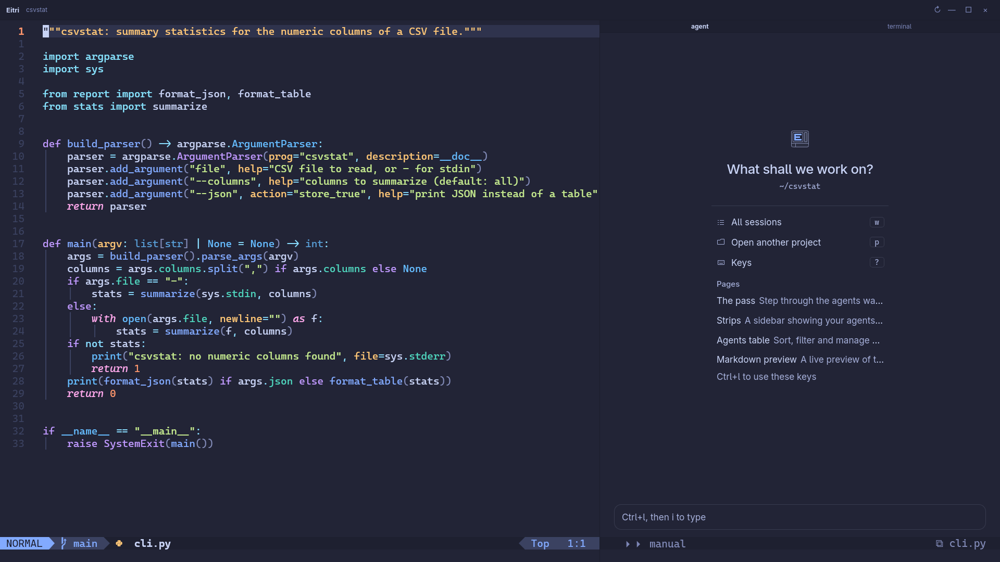
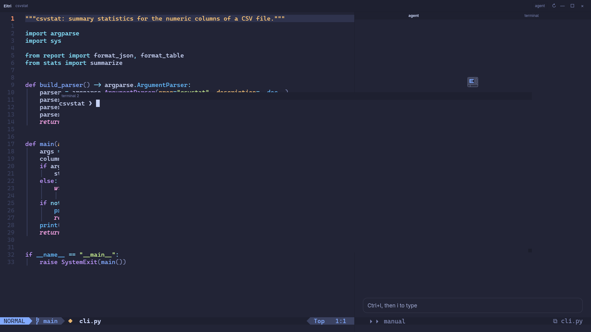

[English](README.md) | 简体中文
<!-- translated-from: README.md sha256=8008b9b4582b6d43f3ac6da85e4aabbe1dd59b79571b6dd9b40efd2c36d64171 -->

# i3 用户

适合你，如果你用 i3 或 sway、并把 Alt 当作 `$mod`，想让 Eitri 的模块像 i3 的容器一样，在同一个 Eitri 窗口里排布。

Eitri 的容器键是在前缀之后按的 i3 `$mod` 组合键（`<prefix> Alt+w` 把一个容器变成标签式）。如果 Alt 是你的窗口管理器的 `$mod`，这些组合键会先被窗口管理器截走。[`init.lua`](init.lua)：

- 把它们移到 `Ctrl+Alt`（`eitri.keymap.use("i3-alt")`）：`<prefix> Ctrl+Alt+w` 标签式，`<prefix> Ctrl+Alt+s` 堆叠式，`<prefix> Ctrl+Alt+Enter` 新终端，`<prefix> Ctrl+Alt+h/j/k/l` 移动；
- 让聊天和页面留在 Eitri 的窗口里（`window.tiling = "eitri"`）。在 sway、Hyprland 和 niri 上，否则它们会成为你的窗口管理器的窗口；如果你想让 sway 来平铺它们，就删掉那一行，并见[合成器窗口](../../../docs/guide/compositor-windows.zh-CN.md)；
- 启动时编辑器在左边，聊天和终端作为标签页在右边，`Ctrl+h` 和 `Ctrl+l` 在标签页之间切换；
- 新终端和新聊天视图作为你所在容器的标签页打开；
- 把 `<prefix> F2` 做成下拉终端，也就是 i3 的 scratchpad：它把终端 2 浮在窗口上显示出来，再按一次就收起来。

把 `init.lua` 复制到 `~/.config/eitri/init.lua`，或者把你想要的部分粘贴进你自己的，再打开一个新窗口。

