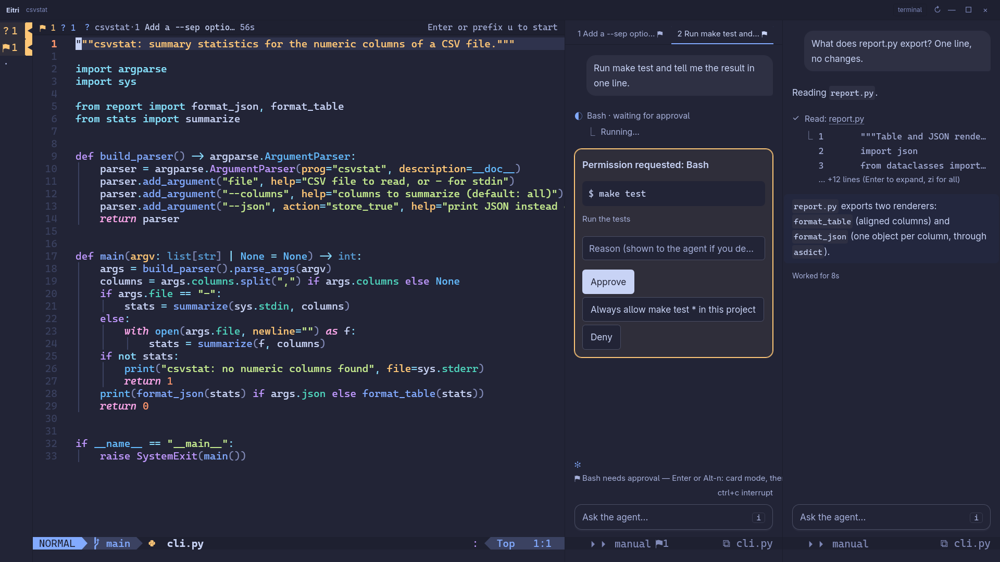
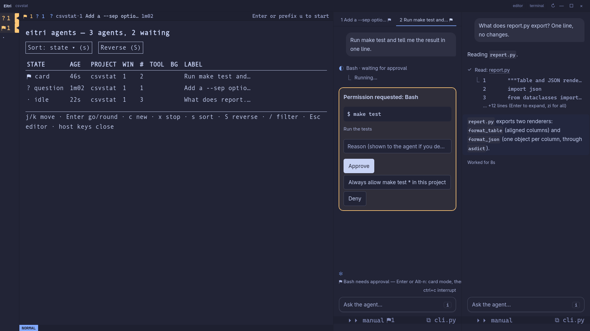

English | [简体中文](README.zh-CN.md)

# Someone running many agents

For you if several agents work for you at once, in several tabs and windows, and the question is which of them needs
you now.

[`init.lua`](init.lua) loads the three pages of [Many agents at once](../../../docs/guide/many-agents.md):

- Strips as a narrow rail at the window's left edge, 62 pixels wide: a glyph, what waits and the tab number for each
  agent. `<prefix> U` shows it with the keys and hides it again.
- The pass, a line above the editor that is there only while an agent waits or a round runs. `<prefix> u` goes to the
  agent that has waited longest and on to the next, `<prefix> B` back to where you started.
- The table, like `top`, on `<prefix> g`: sort, filter, open a new agent, ask one to stop.

It also opens new chat views (`<prefix> !` breaks the tab you are on out into one) to the right of the module with
the keys, starts with the editor and the chat side by side, and brings a hidden chat back when a permission card
arrives in it, without moving the keys.

Copy `init.lua` to `~/.config/eitri/init.lua`, or paste the parts you want into yours, and open a new window.

