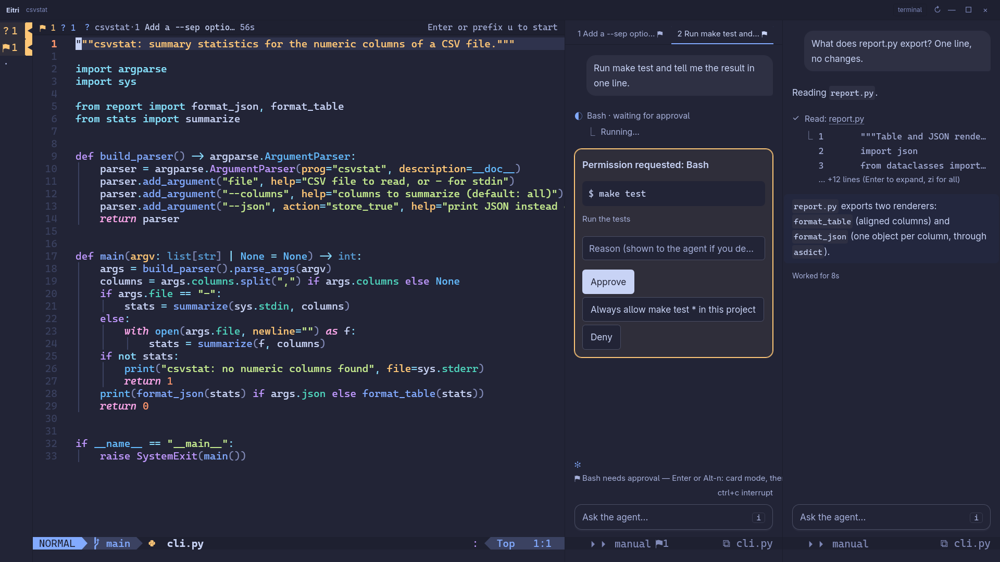
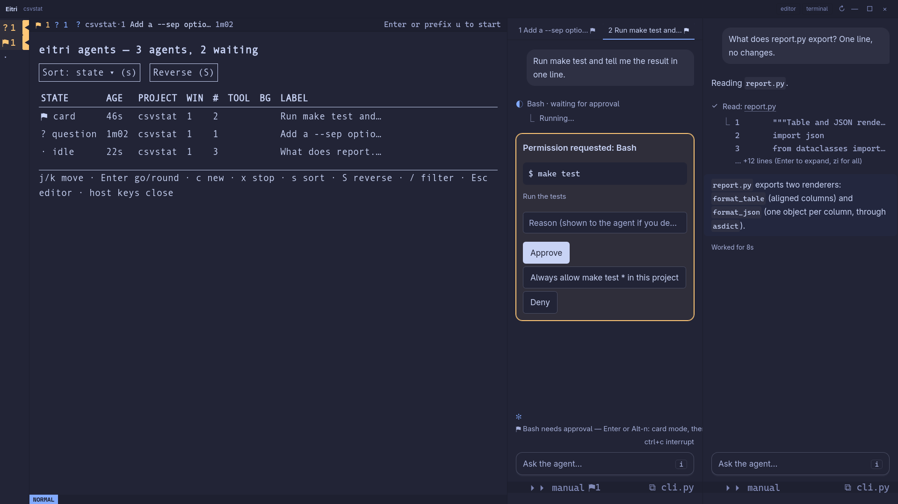

[English](README.md) | 简体中文
<!-- translated-from: README.md sha256=3151e8add88f92c2ef332d97f48e238bb458f9ec29a1344fd8b1a0136c965dae -->

# 同时跑很多 agent 的人

适合你，如果有好几个 agent 同时为你工作，分在几个标签页和窗口里，而问题是它们当中哪个现在需要你。

[`init.lua`](init.lua) 加载[同时用很多 agent](../../../docs/guide/many-agents.zh-CN.md)里的三个页面：

- Strips 是窗口左边缘一条 62 像素宽的窄栏：每个 agent 一个图标、在等的是什么，以及标签页编号。`<prefix> U` 把它连同按键一起显示出来，再按一次就隐藏。
- The pass 是编辑器上方的一行，只在有 agent 在等或一轮在进行时才有。`<prefix> u` 去到等得最久的 agent，再按去下一个，`<prefix> B` 回到你出发的地方。
- 表格像 `top` 一样，在 `<prefix> g` 上：排序、过滤、新开一个 agent、请一个停下来。

它还把新的聊天视图（`<prefix> !` 把你所在的标签页拆出来成为一个）开在拿着按键的模块的右边，启动时编辑器和聊天并排，并在一张权限卡片到达时把隐藏的聊天带回来，不移动按键。

把 `init.lua` 复制到 `~/.config/eitri/init.lua`，或者把你想要的部分粘贴进你自己的，再打开一个新窗口。

