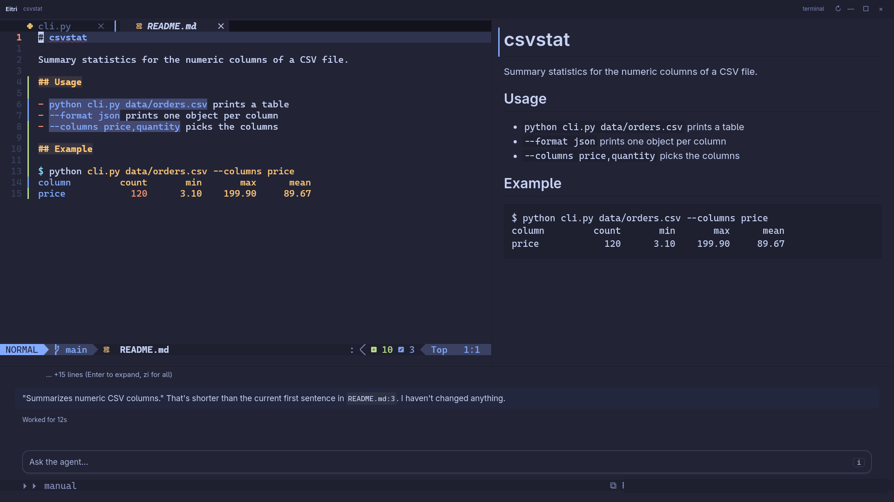

English | [简体中文](README.zh-CN.md)

# A Markdown writer

For you if you write documents, notes or a book in Markdown and want to see the result while you type, with an agent
at hand to read or check what you wrote.

[`init.lua`](init.lua):

- loads the [Markdown preview](../../../docs/guide/markdown-preview.md) with `auto` on: whenever a Markdown file becomes
  the current buffer, the preview opens to the right of the module that has the keys (the editor, while you edit)
  without taking them, and scrolls with the editor both ways;
- gives the preview `<prefix> b`, which shows it with the keys (read it with `j`, `k`, `/` and `f`) and hides it again;
- starts with the editor on top and the chat in a strip below it;
- after a turn that changed files, shows the short hint `c to review`.

Copy `init.lua` to `~/.config/eitri/init.lua`, or paste the parts you want into yours, and open a new window.

