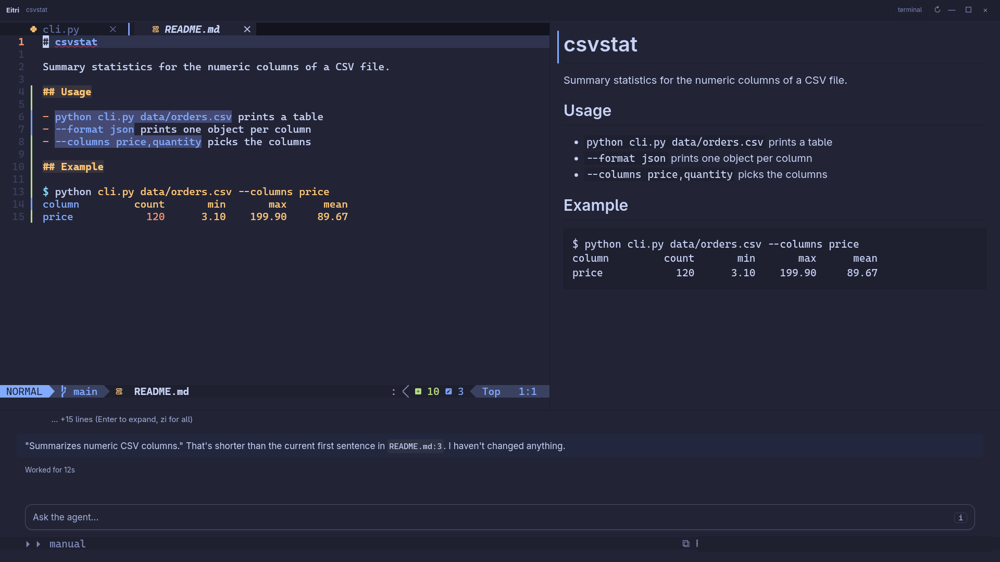

[English](README.md) | 简体中文
<!-- translated-from: README.md sha256=40ae0a3d4e390a424ed2698aa16ef327dc0eb51bc043dedfa434ab4a1e18834e -->

# Markdown 写作者

适合你，如果你用 Markdown 写文档、笔记或一本书，想一边打字一边看到结果，手边还有一个 agent 来读或检查你写的东西。

[`init.lua`](init.lua)：

- 加载 [Markdown 预览](../../../docs/guide/markdown-preview.zh-CN.md)并打开 `auto`：只要一个 Markdown 文件成为当前缓冲区，预览就在拿着按键的模块（你编辑时就是编辑器）右边打开，但不拿走按键，并且和编辑器双向同步滚动；
- 给预览绑了 `<prefix> b`，它把预览连同按键一起显示出来（用 `j`、`k`、`/` 和 `f` 阅读），再按一次就隐藏；
- 启动时编辑器在上面，聊天是它下方的一条窄带；
- 一轮改了文件之后，显示一个简短的提示 `c to review`。

把 `init.lua` 复制到 `~/.config/eitri/init.lua`，或者把你想要的部分粘贴进你自己的，再打开一个新窗口。

