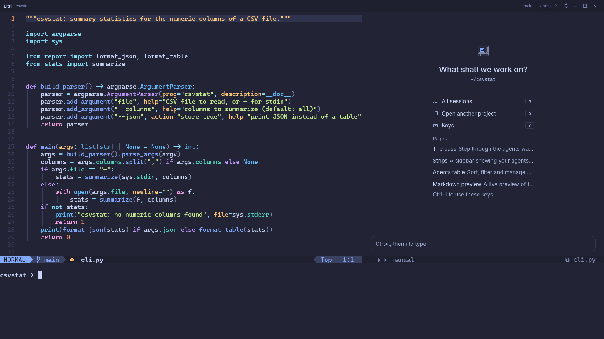
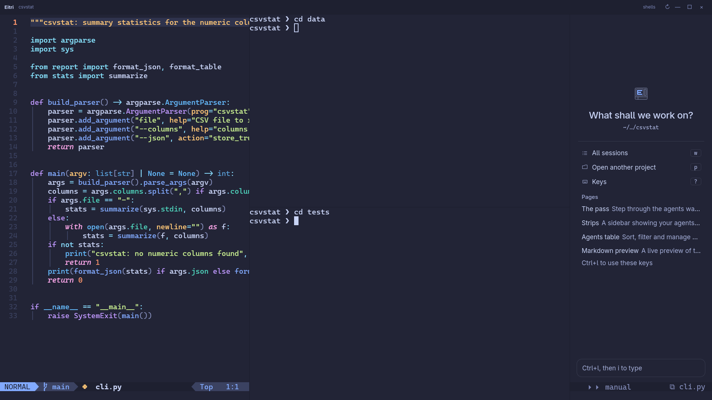

English | [简体中文](README.zh-CN.md)

# A tmux person

For you if you live in tmux: a prefix, panes you split and resize from the keyboard, windows you switch between.
[Coming from tmux](../../../docs/guide/migrate-from-tmux.md) says what comes over from tmux and what does not.

Eitri reads your tmux configuration when it starts (`keymap.from_tmux`), so your prefix and the keys you bound after
it already work in Eitri as they do in tmux. [`init.lua`](init.lua) adds:

- `<prefix> \` and `<prefix> -` split to the right and below, as `%` and `"` do: each then waits for a module key, so
  `<prefix> \ t` opens a new terminal to the right. Split from a terminal, the new shell starts in that terminal's
  directory.
- A new terminal from `<prefix> Alt+Enter` opens below the module you are in, taking 35% of its space.
- The first window has the editor and the chat side by side, with the terminal along the bottom.
- A second workspace, `shells`, holds two terminals between the editor and the chat. `<prefix> (` and `)` step
  between workspaces, `<prefix> L` goes back to the last one and `<prefix> s` chooses one.
- After the prefix, the list of keys that may follow appears if you wait 0.8 seconds.

Copy `init.lua` to `~/.config/eitri/init.lua`, or paste the parts you want into yours, and open a new window. If your
tmux configuration binds `\` or `-` to something else, the call here wins, and Eitri says nothing about the tmux
binding it replaced.

