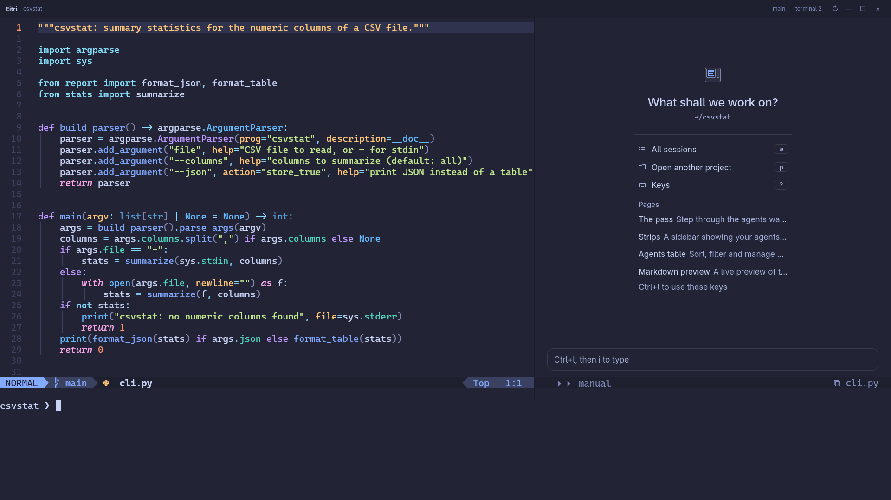
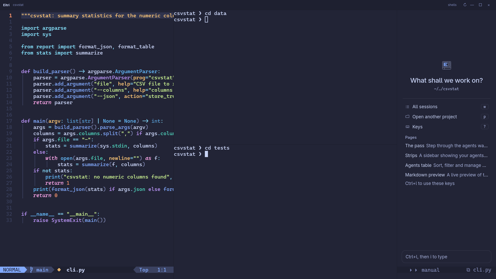

[English](README.md) | 简体中文
<!-- translated-from: README.md sha256=5c9ad790c0ce77fa6992e8eb4483210f56d62674aa1ff1d0ba82e09264bb683c -->

# tmux 用户

适合你，如果你整天待在 tmux 里：有一个前缀，用键盘分割和调整窗格，在窗口之间切换。

Eitri 启动时会读你的 tmux 配置（`keymap.from_tmux`），所以你的前缀和你在它后面绑定的键在 Eitri 里已经像在 tmux 里一样能用。[`init.lua`](init.lua) 另外加了：

- `<prefix> \` 和 `<prefix> -` 分别向右和向下分割，和 `%`、`"` 一样：按下之后各自等一个模块键，所以 `<prefix> \ t` 在右边新开一个终端。从终端里分割时，新 shell 在那个终端所在的目录里启动。
- `<prefix> Alt+Enter` 开的新终端在你所在模块的下方，占它 35% 的空间。
- 第一个窗口里编辑器和聊天并排，终端在底部。
- 第二个工作区 `shells` 在编辑器和聊天之间放两个终端。`<prefix> (` 和 `)` 在工作区之间切换，`<prefix> L` 回到上一个，`<prefix> s` 选一个。
- 按下前缀之后，如果你等 0.8 秒，会出现可以接着按的键的列表。

把 `init.lua` 复制到 `~/.config/eitri/init.lua`，或者把你想要的部分粘贴进你自己的，再打开一个新窗口。如果你的 tmux 配置把 `\` 或 `-` 绑到了别的东西上，这里的调用优先，Eitri 不会提它替换掉的 tmux 绑定。

